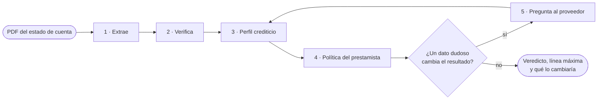
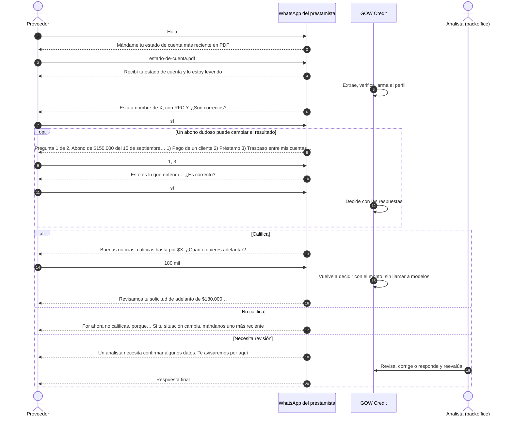
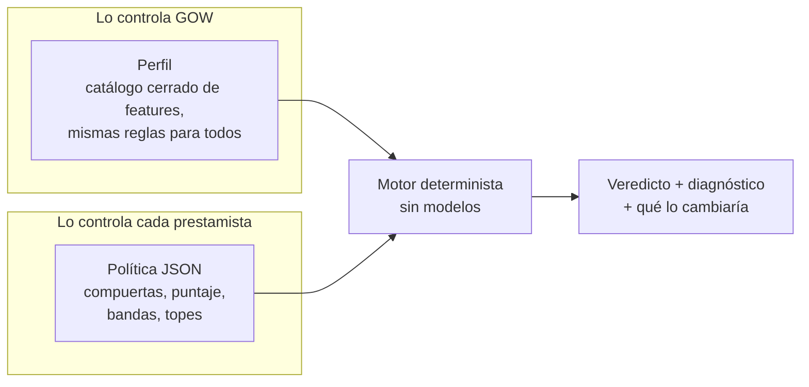
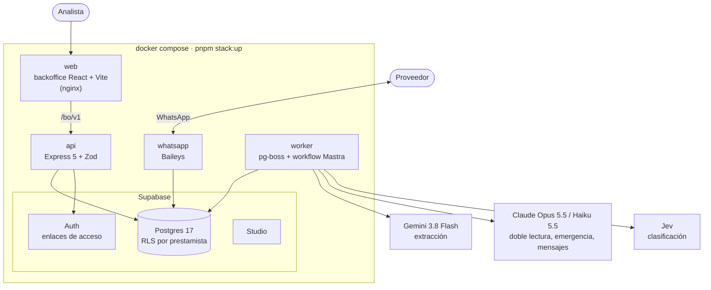
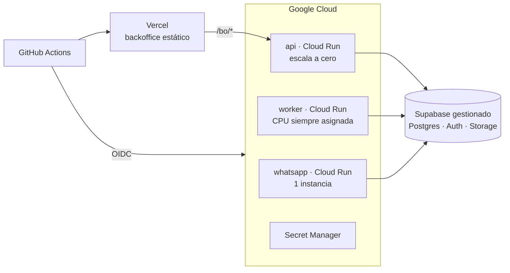

<div align="center">

# GOW Credit

### Decisiones de pronto pago a partir de un estado de cuenta, por WhatsApp.

Un proveedor manda su estado de cuenta en PDF. Unos minutos después sabe cuánto le pueden adelantar
del pago de sus facturas, y por qué. Si algo del estado de cuenta no está claro y puede cambiar la
respuesta, el sistema le pregunta antes.

[](https://github.com/moydany/gow-credit/actions/workflows/ci.yml)

[English](README.md) · **Español**

<br/>

| **1,513 / 1,513** | **0** | **9 / 9** | **USD 0.20** |
|:---:|:---:|:---:|:---:|
| movimientos extraídos | inventados u omitidos | estados de cuenta que cuadran | por documento |

<sub>Sobre los 9 estados de cuenta de desarrollo, con Gemini 3.8 Flash.</sub>

</div>

---

## Contenido

1. [Para quien evalúa](#para-quien-evalúa)
2. [El problema en un minuto](#el-problema-en-un-minuto)
3. [Qué hace](#qué-hace)
4. [Requisitos](#requisitos)
5. [Levantarlo con Docker Compose](#levantarlo-con-docker-compose)
6. [Configuración inicial](#configuración-inicial)
7. [Cómo opera la demo](#cómo-opera-la-demo)
8. [Cómo se decide el crédito](#cómo-se-decide-el-crédito)
9. [Qué se puede configurar](#qué-se-puede-configurar)
10. [Arquitectura](#arquitectura)
11. [Precisión y cómo se vigila al modelo](#precisión-y-cómo-se-vigila-al-modelo)
12. [CI/CD y despliegue](#cicd-y-despliegue)
13. [Límites conocidos](#límites-conocidos)
14. [Mapa del repositorio](#mapa-del-repositorio)

## Para quien evalúa

| Entregable | Dónde |
|---|---|
| Código y cómo correrlo | Este README, desde [Levantarlo con Docker Compose](#levantarlo-con-docker-compose) |
| Lo que entendimos, supuestos y alcance | [`docs/00-spec.md`](docs/00-spec.md) |
| Decisiones de diseño y por qué | [Arquitectura](#arquitectura), [Cómo se decide el crédito](#cómo-se-decide-el-crédito) y el diseño completo en `docs/01` a `docs/09` |
| Prompts | [`prompts/`](prompts/), versionados, con su [changelog](prompts/CHANGELOG.md) |
| Contratos de datos | [`docs/schema/`](docs/schema/), JSON Schema generado desde los contratos Zod |
| CI/CD | [`.github/workflows/`](.github/workflows/) y [CI/CD y despliegue](#cicd-y-despliegue) |
| Despliegue | Demo corriendo en Railway + Supabase; plan de producción en [`docs/deploy.md`](docs/deploy.md) |

## El problema en un minuto

Los proveedores de una cadena de distribución esperan semanas para cobrar. Un prestamista puede
adelantarles el pago de sus facturas, pero decidir quién califica se hace a mano: alguien abre el
estado de cuenta, lo lee renglón por renglón y adivina qué abonos son ventas reales. Eso toma días.

GOW Credit lo baja a minutos, sin pedirle a nadie que confíe en una caja negra:

- **Cada cifra se puede rastrear.** Cada valor trae la página y el fragmento de donde salió.
- **La aritmética del banco es el árbitro.** Si la extracción no cuadra, el sistema lo nota.
- **Ningún modelo toma la decisión.** Los modelos leen y redactan. Un motor determinista aplica la
  política del propio prestamista.
- **Un "no" trae un camino.** La respuesta dice qué la cambiaría.
- **En la duda, pregunta.** Una pregunta corta por WhatsApp es mejor que un rechazo equivocado.

## Qué hace



1. **Extrae** el encabezado, el resumen, cada movimiento y el CFDI que el banco timbra en el estado de
   cuenta, cada uno con su página y su fragmento.
2. **Verifica** contra la aritmética del banco: saldo inicial más abonos menos cargos igual a saldo
   final, totales y conteos impresos, saldo corrido, CLABE, RFC y fechas. Lo que no cuadra se relee
   página por página.
3. **Arma un perfil**: ingreso operativo, capacidad de pago, servicio de deuda, ingresos recurrentes,
   pagos del comprador, alertas.
4. **Aplica la política del prestamista** (cada prestamista es un tenant) con un motor puro.
5. **Pregunta al proveedor** por WhatsApp cuando un abono ambiguo puede cambiar el resultado, y luego
   decide.

Cada solicitud termina en uno de seis estados:

| Estado | Significa |
|---|---|
| `qualified` | Califica con la línea completa de su banda de puntaje |
| `qualified_with_limit` | Califica con una línea menor o con tope |
| `not_qualified` | No califica; el diagnóstico dice qué lo cambiaría |
| `needs_clarification` | Espera una respuesta del proveedor |
| `human_review` | Un analista confirma antes de que alguien reciba respuesta |
| `failed` | No se pudo leer el documento; el motivo queda registrado |

## Requisitos

| Necesitas | Para qué |
|---|---|
| **Docker** con **Compose v2** (Docker Desktop en macOS o Windows) | Todo corre en contenedores. Compose tiene que soportar `--wait` |
| **Node 24+** y **pnpm** (`corepack enable`) | Solo para lanzar `pnpm stack:up` y generar los secretos locales la primera vez. No hace falta `pnpm install` |
| Unos **8 GB de disco** libres | Las imágenes de Supabase (unos 6.5 GB) más la de la app |
| Puertos libres en `127.0.0.1` | `5173` (backoffice), `3000` (API), `54340`–`54343` (Postgres, gateway, Studio, correo) |
| **`ANTHROPIC_API_KEY`** (obligatoria) | Doble lectura, extracción de emergencia, clasificación de respaldo y mensajes al proveedor |
| **`GEMINI_API_KEY`** (recomendada) | Extracción con Gemini 3.8 Flash. Sin ella extrae Claude Opus 5.5, unas 5 veces más caro |
| `TYPESAFE_API_KEY` (opcional) | Clasificación con Jev. Sin ella clasifica Claude Haiku 5.5 |
| `RESEND_API_KEY` y `RESEND_FROM` (opcional) | Correos de acceso al backoffice por Resend. Sin ellas llegan al buzón local |
| Un **teléfono con WhatsApp** | Para vincular el número del prestamista escaneando un QR. Mejor un número de prueba |

## Levantarlo con Docker Compose

```bash
git clone https://github.com/moydany/gow-credit.git
```

```bash
cd gow-credit
```

```bash
cp .env.example .env
```

Abre `.env` y llena al menos `ANTHROPIC_API_KEY` y `GEMINI_API_KEY`. Después:

```bash
pnpm stack:up
```

La primera vez genera los secretos de desarrollo, descarga Supabase y construye la imagen de la app,
así que tarda unos minutos. Termina cuando todos los servicios están sanos e imprime dónde quedó cada
cosa:

| Dirección | Qué es |
|---|---|
| http://127.0.0.1:5173 | **Backoffice.** La primera vez abre el asistente de configuración |
| http://127.0.0.1:3000 | API |
| http://127.0.0.1:54342 | Supabase Studio, para ver la base |
| http://127.0.0.1:54343 | Buzón local con los correos de acceso |

| Comando | Qué hace |
|---|---|
| `pnpm stack:up` | Genera los secretos que falten, construye y levanta todo |
| `pnpm stack:ps` | Estado de cada servicio |
| `pnpm stack:logs` | Sigue los registros de la API, el worker y WhatsApp |
| `pnpm stack:down` | Detiene todo y conserva los datos |
| `pnpm stack:reset` | Detiene y borra la base, la sesión de WhatsApp y los documentos |

> [!TIP]
> ¿Los puertos 5173 o 3000 están ocupados? `GOW_WEB_PORT=8080 GOW_API_PORT=3100 pnpm stack:up`.

> [!NOTE]
> Todo escucha solo en `127.0.0.1`. Los secretos que genera `pnpm stack:up` son de desarrollo y viven
> en `infra/supabase/.env`, fuera de git.

## Configuración inicial

Con el sistema vacío, el backoffice abre un asistente de dos pasos. No hace falta la terminal.

1. **Cuenta.** Escribe el nombre del prestamista y el correo del administrador. Se crean el
   prestamista, su política base activa y el administrador, y entras con una sesión de 8 horas.
2. **WhatsApp.** Aparece un QR. En el teléfono: *WhatsApp → Dispositivos vinculados → Vincular un
   dispositivo*, y escanéalo. Unos segundos después el backoffice muestra el número vinculado. Puedes
   *Omitir por ahora* y vincularlo después en **Configuración → General → Canales**; mientras tanto,
   las aclaraciones se responden a mano en el backoffice.

De ahí en adelante, en **Configuración**:

- **Usuarios**: invita a más personas. Les llega un enlace de acceso por correo (al buzón local en
  `:54343` si no configuraste Resend).
- **Volver a entrar**: en `/entrar`, escribe tu correo y abre el enlace que te llega.

## Cómo opera la demo

El prestamista vincula un número y los proveedores le escriben. Cualquier número desconocido puede
registrarse mandando su estado de cuenta (se apaga con `WHATSAPP_SELF_REGISTRATION=false`).



**Lo que hace el bot en cada paso**

- **Registro.** Lee el titular y el RFC del estado de cuenta y pide confirmarlos. Si no son
  correctos, pide nombre y RFC; con un RFC de persona moral, también al representante legal. El RFC
  que escribe tiene que empezar como el impreso en el estado de cuenta.
- **Documentos que no sirven.** Un PDF con contraseña, un escaneo ilegible, algo que no es estado de
  cuenta o varios estados de cuenta en un PDF reciben cada uno una respuesta concreta, y el bot
  espera otro PDF.
- **Preguntas.** Una a la vez, con opciones numeradas. Acepta varias respuestas en un mensaje
  (`1, 3`), correcciones libres ("me equivoqué, la 2 era préstamo") y "no sé". Antes de evaluar
  muestra un resumen para confirmar. Lo que las reglas no entienden lo lee Claude Haiku, pero solo
  eligiendo entre las opciones ofrecidas; nunca inventa una respuesta.
- **Monto.** Primero ofrece la línea máxima y luego pregunta cuánto quiere adelantar ("180000",
  "180 mil", "1.2 millones" u "omitir"). Más que la línea se vuelve a preguntar.
- **Lo que nunca sale por el chat:** saldos, CLABE, ni los motivos internos del motor.

**En el backoffice** (http://127.0.0.1:5173)

| Pantalla | Para qué |
|---|---|
| Solicitudes | Cada solicitud con su estado, línea y alertas |
| Detalle | El PDF junto a la extracción: un clic en un valor salta a su página y fragmento. Perfil, veredicto con el diagnóstico completo y contrafactuales |
| Recorrido | La solicitud paso a paso en 3D: mensajes, lecturas, llamadas a modelos y decisiones |
| Aclaraciones | Preguntas pendientes; se responden a mano cuando el proveedor no tiene WhatsApp |
| Revisión | Correcciones del analista sobre la extracción, guardadas como pares inmutables y reevaluadas |
| Proveedores | Alta, búsqueda y baja de proveedores con todo lo suyo |
| Outcomes | Si cada crédito se pagó o cayó en mora, para medir la política |
| Bitácora | Quién hizo qué, y cada llamada a un modelo con su costo |
| Configuración | General (antigüedad del estado de cuenta, WhatsApp, usuarios), políticas y prompts |

## Cómo se decide el crédito

GOW Credit no presta. Le da a cada prestamista la infraestructura para aplicar **su** política, así
que la decisión vive en tres capas separadas.



**Por qué así.** Un "no" a secas no le sirve ni al proveedor ni al prestamista. El motor devuelve el
resultado, cada razón detrás de él y los **contrafactuales**: el cambio mínimo que movería el estado o
la línea ("con dos pagos más del comprador pasarías a `qualified`"). Un rechazo se vuelve un camino. Y
como el motor es puro, la misma extracción, la misma política y la misma fecha dan siempre el mismo
veredicto.

### 1. Compuertas: lo que detiene una solicitud antes de puntuar

| Compuerta | Pasa si | Si no | Por qué |
|---|---|---|---|
| Estado de cuenta reciente | El corte tiene 90 días o menos | Pide uno más reciente | Un estado de cuenta viejo no describe el flujo de hoy. En el backoffice se puede volver una alerta |
| Páginas completas | Trae todas las páginas que imprime su paginación | Pide las que faltan | Una página omitida puede esconder cargos |
| Integridad | Cuadra contra los saldos y totales del banco | `human_review` | Si no cuadra, la extracción o el documento tienen un problema |
| Sin alertas | Sin sobregiro, cheque devuelto, embargo, orden judicial ni requerimiento fiscal | `human_review` | Señales de riesgo que debe ver una persona |
| Sin manipulación | Sin texto dirigido al sistema, timbrado coherente, sin páginas repetidas | `human_review` | Protege contra documentos alterados e instrucciones escondidas |
| Sin atraso | Sin días de atraso en créditos vigentes con este prestamista | `not_qualified` | Un atraso de hoy pesa más que cualquier puntaje |

### 2. Puntaje: cinco dimensiones, de 0 a 100

| Dimensión | Peso | Qué mide | 0 puntos con | Completo con |
|---|---:|---|---|---|
| Capacidad | 35 | Ingreso operativo mensual frente al monto pedido | 0.5× el monto | 3× el monto |
| Comprador | 25 | Pagos identificados del comprador (la cadena) | 0 pagos | 2 pagos |
| Estabilidad | 15 | Capacidad de pago: flujo libre / ingresos | 10 % | 50 % |
| Deuda | 15 | Servicio de deuda / ingresos (menos es mejor) | 40 % | 10 % |
| Recurrencia | 10 | Parte de los ingresos que se repite | 20 % | 60 % |

**Por qué estos pesos.** El pronto pago se paga con el flujo del propio proveedor y, sobre todo, con
la factura que le debe la cadena. Por eso capacidad y comprador suman 60. El "ingreso operativo"
excluye traspasos entre cuentas propias, préstamos recibidos y abonos dudosos: inflar ingresos con
dinero propio es el truco más común en un estado de cuenta. Un dato con confianza menor a 0.7 no
cuenta para el puntaje.

### 3. Bandas, topes y línea

| Puntaje | Estado | Línea de la banda |
|---|---|---|
| 70 o más | `qualified` | 50 % del ingreso operativo mensual |
| 50 a 69 | `qualified_with_limit` | 25 % del ingreso operativo mensual |
| Menos de 50 | `not_qualified` | — |

- **Topes.** Con menos de 3 meses de historia, o sin ningún pago del comprador, lo máximo es
  `qualified_with_limit`. Poca historia no alcanza para la línea completa.
- **Línea final** = la menor entre la línea de la banda, la capacidad de endeudamiento menos lo que
  ya le debe a este prestamista, y lo que queda en el programa del comprador.
- **Aclaraciones.** Hasta 2 rondas. Solo se pregunta por abonos dudosos mayores al 30 % de los
  ingresos del periodo que puedan cambiar el estado o la línea.

## Qué se puede configurar

| Dónde | Qué | Valores |
|---|---|---|
| Backoffice → Configuración → General | Antigüedad máxima del estado de cuenta | 1, 2, 3 (por defecto), 6 o 12 meses, o sin límite. Fuera del límite la solicitud lleva una alerta, no se bloquea |
| Backoffice → Configuración → General | Número de WhatsApp | Vincular, desvincular o cambiar escaneando un QR |
| Backoffice → Configuración → General | Usuarios | Invitar o quitar personas; todas ven y operan las solicitudes del prestamista |
| Backoffice → Configuración → Políticas | **La política completa** | Un borrador JSON validado con el mismo esquema del motor. Antes de activarlo, se **simula** contra solicitudes reales: cuántas mejoran, empeoran o cambian de línea, y la mora observada. Cada versión queda guardada |
| Backoffice → Configuración → Prompts | Los prompts de los modelos | Editar crea una versión nueva y activarla es otro paso; las versiones se pueden comparar. Son los mismos para todos los prestamistas |
| `.env` | Llaves de modelos y correo | Ver [Requisitos](#requisitos) |
| `.env` | `LLM_CACHE_MODE` | `readwrite` (por defecto) o `read`: con `read` nunca se llama a un modelo y repetir cuesta cero |
| `.env` | `WORKER_MODEL_CONCURRENCY` | Llamadas a modelos en paralelo (por defecto 3) |
| `.env` | `WHATSAPP_SELF_REGISTRATION` | `true` (por defecto) o `false` |
| `.env` | `GOW_TIME_ZONE` | Zona del calendario de negocio (por defecto `America/Mexico_City`) |
| Al levantar | `GOW_WEB_PORT`, `GOW_API_PORT` | Puertos del backoffice y la API |

<details>
<summary><b>Qué trae una política</b></summary>

<br/>

La plantilla base está en [`policies/gow-base.v1.json`](policies/gow-base.v1.json) y su esquema en
[`docs/schema/policy.schema.json`](docs/schema/policy.schema.json).

| Campo | Define |
|---|---|
| `gates[]` | Compuertas: `feature`, operador, valor, qué pasa si falla (`onFail`) y si el dato falta (`onUnknown`) |
| `score.dimensions[]` | Dimensiones con `weight`, `zeroAt`, `fullAt`, `relativeTo` e `inverse` |
| `score.minConfidence` | Confianza mínima para que un dato cuente |
| `decision.bands[]` | Puntaje mínimo, estado y línea (`pctOf` de una feature) |
| `decision.caps[]` | Condiciones que limitan el mejor estado posible |
| `decision.limitFormula` | Cómo se combina la línea final |
| `clarification` | Rondas máximas y desde qué tamaño de abono se pregunta |

Una política solo puede usar features del catálogo cerrado; si nombra una que no existe, no valida.

</details>

## Arquitectura



Una sola imagen corre la API, el worker y WhatsApp; la variable `APP` elige cuál. Los procesos nunca
se llaman entre sí: se coordinan por la base (cola, buzón de salida y estados), así que cualquiera
puede reiniciarse sin perder trabajo.

**El recorrido de un PDF.** WhatsApp lo guarda y abre una solicitud → la cola le entrega el trabajo al
worker → el workflow extrae, verifica, arma el perfil y decide → si hay preguntas, el workflow se
**suspende** y la pregunta sale por el buzón → la respuesta del proveedor **reanuda** el workflow, que
decide → el veredicto sale por WhatsApp.

### Por qué cada pieza

| Pieza | Para qué | Por qué esta |
|---|---|---|
| **Gemini 3.8 Flash** | Leer el estado de cuenta | En los 9 estados de cuenta de desarrollo empató con Claude Opus (1,513 de 1,513 movimientos, 9 de 9 cuadran) a una quinta parte del costo: USD 1.80 contra 9.16. Recibe el PDF completo y el esquema de salida, con caché implícita |
| **Claude Opus 5.5** | Emergencia y relecturas | Si Google se cae, Opus rehace el documento. Si un bloque no cuadra, Opus lo relee. La doble lectura del encabezado usa la otra familia de modelos, para que dos errores iguales sean improbables |
| **Claude Haiku 5.5** | Mensajes y respuestas del proveedor | Redacta las preguntas en lenguaje simple y lee las respuestas que las reglas no entienden, siempre eligiendo entre opciones cerradas. Rápido y barato para textos cortos |
| **Jev** (TypeSafe AI) | Clasificar documentos y movimientos ambiguos | Da probabilidades calibradas por pregunta, no solo una etiqueta, que es lo que hace falta para decidir *cuándo preguntar*. 32 de 33 en la eval del clasificador, unos USD 0.015 por cada 1,000 movimientos. Las reglas van primero y Jev solo ve lo que no resuelven; sin llave, Haiku toma su lugar |
| **Mastra** | Orquestar el workflow | El problema es un pipeline con una pausa que puede durar días: esperar al proveedor. Mastra da `suspend()` y `resume()` persistidos en Postgres, salida estructurada y trazas. La alternativa era escribir a mano una máquina de estados. Donde Mastra oculta algo que hay que medir, el código baja al SDK |
| **Supabase** | Base, acceso y archivos | Postgres con **RLS forzada** por prestamista (filtrar datos entre prestamistas es el peor incidente posible), Auth para los enlaces de acceso y Storage, en un solo servicio. En local corre autohospedado con los mismos roles que en producción |
| **pg-boss** | Cola de trabajos | Leer un PDF largo toma minutos. pg-boss vive en el mismo Postgres (sin otro broker), con reintentos, cola de fallidos y llave de idempotencia por hash del documento: un PDF repetido nunca se paga dos veces |
| **Baileys** | WhatsApp | Vincula un número normal con un QR, sin aprobar plantillas con Meta. Bien para una demo; producción usaría la API oficial detrás de la misma interfaz |
| **Zod** | Contratos | Una sola fuente de verdad: los tipos, la validación de la API y el JSON Schema de `docs/schema/` salen del mismo esquema |
| **Drizzle** | Acceso a datos | SQL primero, con las políticas RLS en el esquema y migraciones versionadas |
| **React + Vite** | Backoffice | Una app estática que solo habla con `/bo/v1`; en producción va en un CDN |

## Precisión y cómo se vigila al modelo

La extracción es la métrica que más importa, y un modelo puede inventar. Por eso el sistema no le cree
al modelo: lo **verifica**.

| En los 9 estados de cuenta de desarrollo | Gemini 3.8 Flash | Claude Opus 5.5 |
|---|---|---|
| Movimientos extraídos | 1,513 / 1,513 | 1,513 / 1,513 |
| Inventados / omitidos | 0 / 0 | 0 / 0 |
| Encabezado y resumen | 120 / 120 campos | 120 / 120 campos |
| CFDI | 104 / 107 campos | 106 / 107 campos |
| Estados de cuenta que cuadran | 9 / 9 | 9 / 9 |
| Costo de los 9 | USD 1.80 | USD 9.16 |

El ground truth sale de un parser determinista por banco sobre la capa de texto del PDF, arbitrado por
la aritmética del banco, y nunca del modelo que se mide.

**Qué protege en documentos que el sistema nunca vio**

- **Citas.** Cada valor trae su página y su fragmento. Un valor sin cita queda como no verificado.
- **La aritmética del banco como ancla.** Inicial + abonos − cargos = final, totales y conteos
  impresos, y el saldo corrido renglón por renglón. Un error del modelo casi siempre rompe una de esas
  sumas.
- **Relectura dirigida.** Lo que no cuadra se relee solo en su página; si sigue sin cuadrar, se marca y
  el motor lo ve.
- **Doble lectura** del encabezado con la otra familia de modelos. Si no coinciden, se pregunta.
- **Validadores**: dígito de control de la CLABE, estructura del RFC, fechas dentro del periodo,
  cruces con el CFDI.
- **Inyección de instrucciones.** El texto del PDF es dato, nunca instrucción. Una eval con PDFs
  adversarios corre en CI y tiene que pasar al 100 %.
- **Lo que no se puede verificar va marcado**, y si puede cambiar el resultado, se le pregunta al
  proveedor.

**Reproducibilidad.** Cada respuesta de un modelo se guarda con una llave que incluye el modelo, el
prompt, el esquema y el hash del documento, así que repetir con `LLM_CACHE_MODE=read` da exactamente
la misma salida y no cuesta nada. Los modelos, los prompts y las dependencias están fijados. Una
llamada nueva a un modelo no es determinista, pero toda extracción pasa por el mismo contrato, los
mismos validadores y el mismo cuadre; una diferencia entre dos lecturas aparece como alerta o
pregunta, nunca en silencio.

## CI/CD y despliegue

| Workflow | Cuándo corre | Qué hace |
|---|---|---|
| [`ci.yml`](.github/workflows/ci.yml) | Cada push a `main` y cada PR | Typecheck estricto, lint (incluye tamaño, complejidad y duplicados), pruebas unitarias, escenarios de punta a punta con Postgres 17, evals de inyección y del clasificador sin llaves, build del backoffice, imágenes de la API y el worker, gitleaks y osv-scanner |
| [`eval-extraction.yml`](.github/workflows/eval-extraction.yml) | PRs que tocan prompts, extracción, modelos o contratos | Extracción contra el ground truth con umbral por banco. Restaura los datos privados desde un paquete cifrado y falla si una métrica baja del umbral |
| [`deploy.yml`](.github/workflows/deploy.yml) | Solo a mano, por entorno (`staging` o `production`) | Imágenes → migración → servicios en Cloud Run, y el backoffice en Vercel. Sin llaves JSON: identidad federada de GitHub a Google, y `production` pide aprobación |

Hay dos destinos de despliegue:

- **Demo en Railway + Supabase.** Corriendo hoy. Tres servicios en Railway: `app` (API y worker
  juntos, porque comparten el disco de los documentos), `web` (el backoffice estático detrás de nginx,
  que reenvía `/bo` por la red privada) y `whatsapp` (exactamente una instancia). La base y Auth viven
  en un proyecto de Supabase gestionado. Los scripts están en `infra/railway/`: `configure.sh` arma los
  servicios, `set-db-passwords.sh` genera una contraseña por rol de base sin imprimirla, y `deploy.sh`
  sube exactamente un commit con `git archive`, así que nada sin versionar sale de la máquina. Antes
  de cada despliegue de `app` se aplican los roles y las migraciones.
- **Producción en Google Cloud.** Preparado, no ejecutado: no se crearon cuentas en la nube.



Los dos planes, con regiones, parámetros, secretos, costos de operación y lo que falta, están en
[`docs/deploy.md`](docs/deploy.md).

## Límites conocidos

- **Producción no está desplegada.** La demo en Railway corre; el pipeline de Cloud Run está listo pero
  nunca se ha ejecutado.
- **La demo toma dos atajos.** El TLS hacia Supabase no verifica el certificado, y la API y el worker
  escalan juntos.
- **WhatsApp por Baileys**, no por la API oficial de Meta: sirve para una demo, no para producción.
- **Todavía sin SAT ni buró.** El perfil está diseñado para recibirlos como señales nuevas sin cambiar
  el motor, pero no están conectados.
- **Documentos en disco.** Supabase Storage corre, pero su adaptador no está conectado; los PDFs viven
  en un volumen.
- **Los datos de desarrollo se quedan fuera del repositorio.** Estados de cuenta, ground truth y caché
  nunca se versionan.

## Mapa del repositorio

| Carpeta | Qué hay |
|---|---|
| `apps/api` | API HTTP: backoffice, solicitudes, aclaraciones, políticas, asistente inicial |
| `apps/worker` | Cola y workflow: extracción, decisión, mensajes salientes |
| `apps/whatsapp` | Canal de WhatsApp (Baileys) |
| `apps/web` | Backoffice (React 19 + Vite) |
| `packages/contracts` | Contratos Zod: extracción, perfil, política, veredicto, solicitud |
| `packages/extraction` | Ruteo de modelos, pasadas, validadores, cuadre, bloque fiscal |
| `packages/llm` | Modelos y precios, cliente estructurado, caché de respuestas, clasificadores |
| `packages/decision` | Perfil, motor de políticas, contrafactuales y simulación |
| `packages/mastra` | El workflow `processApplication` |
| `packages/db`, `packages/platform`, `packages/channels` | Base con RLS, cola y almacenamiento, conversación de WhatsApp |
| `policies/` | Plantilla base de política |
| `prompts/` | Prompts versionados y su changelog |
| `evals/`, `scenarios/` | Evals de extracción e inyección; escenarios de punta a punta |
| `infra/`, `scripts/` | Supabase local, nginx del backoffice, Railway, `stack.sh` |
| `docs/` | Diseño (`00` a `09`), esquemas, despliegue |
