<div align="center">

# GOW Credit

### Decisiones de pronto pago a partir de un estado de cuenta, por WhatsApp.

Un proveedor manda su estado de cuenta en PDF. Unos minutos después sabe cuánto le pueden adelantar
del pago de sus facturas, y por qué. Si algo del estado de cuenta no está claro y puede cambiar la
respuesta, el sistema le pregunta antes.

<br/>


<sub>Una conversación real con la demo: de <i>Hola</i> a un adelanto aprobado en cuatro minutos. El RFC va difuminado.</sub>

<br/><br/>

[](https://github.com/moydany/gow-credit/actions/workflows/ci.yml)
[](https://github.com/moydany/gow-credit/actions/workflows/railway.yml)

[English](README.md) · **Español**

<br/>

| **1,513 / 1,513** | **0** | **9 / 9** | **USD 0.20** |
|:---:|:---:|:---:|:---:|
| movimientos extraídos | inventados u omitidos | estados de cuenta que cuadran | por documento |

<sub>Sobre los 9 estados de cuenta de desarrollo, con Gemini 3.8 Flash.</sub>

</div>

---

## Contenido

1. [Para quien evalúa](#para-quien-evalúa)
2. [Prueba la demo en vivo](#prueba-la-demo-en-vivo)
3. [El problema en un minuto](#el-problema-en-un-minuto)
4. [Qué hace](#qué-hace)
5. [Correrlo en tu máquina](#correrlo-en-tu-máquina)
6. [Cómo opera la demo](#cómo-opera-la-demo)
7. [Cómo se decide el crédito](#cómo-se-decide-el-crédito)
8. [Qué se puede configurar](#qué-se-puede-configurar)
9. [Arquitectura](#arquitectura)
10. [La demo en Railway](#la-demo-en-railway)
11. [Precisión y cómo se vigila al modelo](#precisión-y-cómo-se-vigila-al-modelo)
12. [CI/CD y el camino a producción](#cicd-y-el-camino-a-producción)
13. [Límites conocidos](#límites-conocidos)
14. [Mapa del repositorio](#mapa-del-repositorio)

## Para quien evalúa

Todo lo que pide el worksample, y dónde está.

| Entregable | Dónde |
|---|---|
| Un sistema funcionando | [Prueba la demo en vivo](#prueba-la-demo-en-vivo), o [córrelo en local](#correrlo-en-tu-máquina) con un comando |
| Lo que entendimos, supuestos y alcance | [`docs/00-spec.md`](docs/00-spec.md) |
| Decisiones de diseño y por qué | [Arquitectura](#arquitectura), [Cómo se decide el crédito](#cómo-se-decide-el-crédito) y el diseño completo en `docs/01` a `docs/09` |
| Prompts | [`prompts/`](prompts/), versionados, con su [changelog](prompts/CHANGELOG.md) |
| Contratos de datos | [`docs/schema/`](docs/schema/), JSON Schema generado desde los contratos Zod |
| CI/CD | [`.github/workflows/`](.github/workflows/) y [CI/CD y el camino a producción](#cicd-y-el-camino-a-producción) |
| Despliegue | [La demo en Railway](#la-demo-en-railway) hoy; el plan de producción en [`docs/deploy.md`](docs/deploy.md) |

> [!NOTE]
> Los documentos de diseño en `docs/` están en español, como los mensajes que el sistema manda a los
> proveedores. El código, los identificadores y los comentarios están en inglés.

## Prueba la demo en vivo

La demo corre en Railway y Supabase, y cada push a `main` que pasa CI la actualiza.

| | URL |
|---|---|
| **Backoffice** | https://web-production-d5e9bd.up.railway.app |
| API | https://app-production-aa52.up.railway.app (salud en [`/healthz`](https://app-production-aa52.up.railway.app/healthz)) |

El registro está cerrado: se entra con un enlace de acceso que llega a un correo invitado. Pide una
invitación, abre el backoffice, ve a `/entrar`, escribe tu correo y abre el enlace que te llega.

> [!TIP]
> ¿Quieres ver las tripas? Cada solicitud muestra el PDF junto a lo que se leyó de él, y la pestaña
> **Recorrido** reproduce paso a paso cada mensaje, llamada a un modelo y decisión.

## El problema en un minuto

Los proveedores de una cadena de distribución esperan semanas para cobrar. Un prestamista puede
adelantarles el pago de sus facturas, pero decidir quién califica se hace a mano: alguien abre el
estado de cuenta, lo lee renglón por renglón y adivina qué abonos son ventas reales. Eso toma días.

GOW Credit convierte eso en minutos, sin pedirle a nadie que confíe en una caja negra:

- **Cada número es rastreable.** Cada valor trae la página y el fragmento de donde salió.
- **La aritmética del banco es el árbitro.** Si la extracción no cuadra, el sistema se da cuenta.
- **Ningún modelo decide.** Los modelos leen y redactan. Un motor determinista aplica la política
  del propio prestamista.
- **Un "no" viene con camino.** La respuesta dice qué lo cambiaría.
- **Ante la duda, pregunta.** Una pregunta corta por WhatsApp vale más que un rechazo equivocado.

## Qué hace

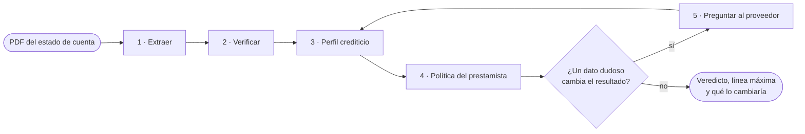

1. **Extrae** el encabezado, el resumen, cada movimiento y el CFDI que el banco imprime en el
   estado de cuenta, cada uno con su página y su fragmento.
2. **Verifica** contra la aritmética del banco: saldo inicial más abonos menos cargos igual al saldo
   final, totales y conteos impresos, saldo corrido, CLABE, RFC y fechas. Lo que no cuadra se relee
   página por página.
3. **Arma un perfil**: ingresos operativos, capacidad de pago, servicio de deuda, ingresos
   recurrentes, pagos del comprador, señales de alerta.
4. **Aplica la política del prestamista** (cada prestamista es un tenant) con un motor puro.
5. **Pregunta al proveedor** por WhatsApp cuando un abono ambiguo puede cambiar el resultado, y
   decide.

Cada solicitud termina en uno de seis estados:

| Estado | Significado |
|---|---|
| `qualified` | Califica a la línea completa de su banda de puntaje |
| `qualified_with_limit` | Califica con una línea menor o acotada |
| `not_qualified` | No califica; el diagnóstico dice qué lo cambiaría |
| `needs_clarification` | Esperando una respuesta del proveedor |
| `human_review` | Un analista confirma antes de que alguien reciba respuesta |
| `failed` | No se pudo leer el documento; queda registrado el motivo |

## Correrlo en tu máquina

El sistema completo, con un Supabase local incluido, se levanta con un comando. Necesitas Docker y
dos llaves de API.

### Qué necesitas

| Necesitas | Para qué |
|---|---|
| **Docker** con **Compose v2** (Docker Desktop en macOS o Windows) | Todo corre en contenedores. Compose tiene que soportar `--wait` |
| **Node 24+** y **pnpm** (`corepack enable`) | Solo para lanzar `pnpm stack:up` y generar los secretos locales la primera vez. No hace falta `pnpm install` |
| Unos **8 GB de disco** libres | Las imágenes de Supabase (unos 6.5 GB) más la de la app |
| Puertos libres en `127.0.0.1` | `5173` (backoffice), `3000` (API), `54340`–`54343` (Postgres, gateway, Studio, correo) |
| **`ANTHROPIC_API_KEY`** (obligatoria) | Doble lectura, extracción de emergencia, clasificación de respaldo y mensajes al proveedor |
| **`GEMINI_API_KEY`** (recomendada) | Extracción con Gemini 3.8 Flash. Sin ella extrae Claude Opus 5.5, unas 5 veces más caro |
| `TYPESAFE_API_KEY` (opcional) | Clasificación con Jev. Sin ella clasifica Claude Haiku 5.5 |
| `RESEND_API_KEY` y `RESEND_FROM` (opcional) | Correos de acceso al backoffice por Resend. Sin ellas llegan al buzón local |
| Un **teléfono con WhatsApp** | Para vincular el número del prestamista escaneando un QR. Mejor un número de prueba |

### Levantarlo

```bash
git clone https://github.com/moydany/gow-credit.git
```

```bash
cd gow-credit
```

```bash
cp .env.example .env
```

Abre `.env` y llena al menos `ANTHROPIC_API_KEY` y `GEMINI_API_KEY`. Después:

```bash
pnpm stack:up
```

La primera vez genera los secretos de desarrollo, descarga Supabase y construye la imagen de la app,
así que tarda unos minutos. Termina cuando todos los servicios están sanos e imprime dónde quedó cada
cosa:

| Dirección | Qué es |
|---|---|
| http://127.0.0.1:5173 | **Backoffice.** La primera vez abre el asistente de configuración |
| http://127.0.0.1:3000 | API |
| http://127.0.0.1:54342 | Supabase Studio, para ver la base |
| http://127.0.0.1:54343 | Buzón local con los correos de acceso |

| Comando | Qué hace |
|---|---|
| `pnpm stack:up` | Genera los secretos que falten, construye y levanta todo |
| `pnpm stack:ps` | Estado de cada servicio |
| `pnpm stack:logs` | Sigue los registros de la API, el worker y WhatsApp |
| `pnpm stack:down` | Detiene todo y conserva los datos |
| `pnpm stack:reset` | Detiene y borra la base, la sesión de WhatsApp y los documentos |

> [!TIP]
> ¿Los puertos 5173 o 3000 están ocupados? `GOW_WEB_PORT=8080 GOW_API_PORT=3100 pnpm stack:up`.

> [!NOTE]
> Todo escucha solo en `127.0.0.1`. Los secretos que genera `pnpm stack:up` son de desarrollo y viven
> en `infra/supabase/.env`, fuera de git.

### Configuración inicial

Con el sistema vacío, el backoffice abre un asistente de dos pasos. No hace falta la terminal.

1. **Cuenta.** Escribe el nombre del prestamista y el correo del administrador. Se crean el
   prestamista, su política base activa y el administrador, y entras con una sesión de 8 horas.
2. **WhatsApp.** Aparece un QR. En el teléfono: *WhatsApp → Dispositivos vinculados → Vincular un
   dispositivo*, y escanéalo. Unos segundos después el backoffice muestra el número vinculado. Puedes
   *Omitir por ahora* y vincularlo después en **Configuración → General → Canales**; mientras tanto,
   las aclaraciones se responden a mano en el backoffice.

De ahí en adelante, en **Configuración**:

- **Usuarios**: invita a más personas. Les llega un enlace de acceso por correo (al buzón local en
  `:54343` si no configuraste Resend).
- **Volver a entrar**: en `/entrar`, escribe tu correo y abre el enlace que te llega.

## Cómo opera la demo

El prestamista vincula un número y los proveedores le escriben. Cualquier número desconocido puede
registrarse: el bot le pide su nombre y cuánto quiere adelantar, y después su estado de cuenta (se
apaga con `WHATSAPP_SELF_REGISTRATION=false`).

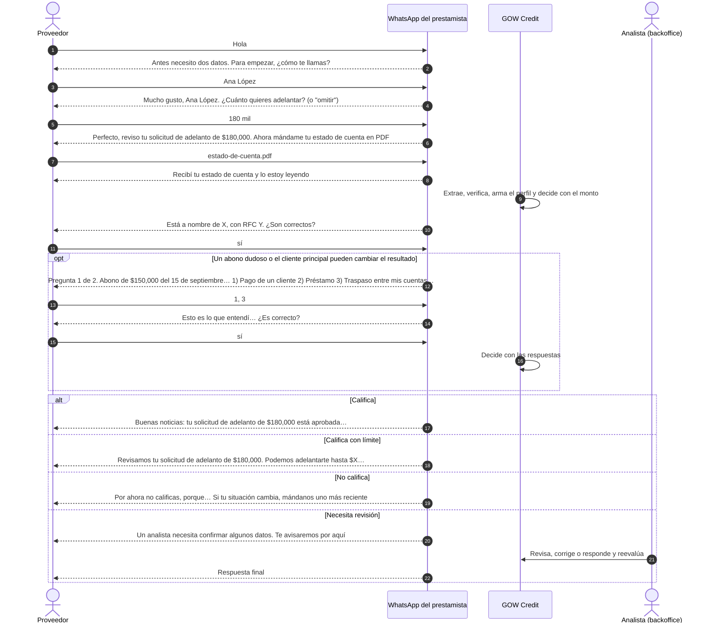

**Lo que hace el bot en cada paso**

- **Saludo.** Pide el nombre de quien escribe y el monto que quiere adelantar ("180000", "180 mil",
  "1.2 millones" u "omitir"); después, el estado de cuenta. Si el PDF llega antes, lo guarda y lo lee
  en cuanto tiene los dos datos.
- **Registro.** Lee el titular y el RFC del estado de cuenta y pide confirmarlos. Si no son
  correctos, pide nombre y RFC; con un RFC de persona moral, también al representante legal. El RFC
  que escribe tiene que empezar como el impreso en el estado de cuenta.
- **Documentos que no sirven.** Un PDF con contraseña, un escaneo ilegible o algo que no es estado de
  cuenta reciben cada uno una respuesta concreta, y el bot espera otro PDF. Un PDF que trae varios
  estados de cuenta sí se acepta: se toman los meses que pide la política.
- **Varios meses.** Si la política evalúa tres, el bot los pide seguidos y juntos, en un solo envío.
  Cuando falta alguno, no vuelve a pedir los tres: dice cuántos faltan y de qué mes es cada uno ("Nos
  falta 1, el estado de cuenta con corte en agosto de 2026"), y un PDF repetido no cuenta como mes nuevo.
- **Preguntas.** Una a la vez, con opciones numeradas. Acepta varias respuestas en un mensaje
  (`1, 3`), correcciones libres ("me equivoqué, la 2 era préstamo") y "no sé". Antes de evaluar
  muestra un resumen para confirmar. Lo que las reglas no entienden lo lee Claude Haiku, pero solo
  eligiendo entre las opciones ofrecidas; nunca inventa una respuesta.
- **Monto.** Con el monto del saludo decide una sola vez con ese monto. Si lo omitió, decide con la
  línea máxima y, si califica, pregunta cuánto quiere adelantar (más que la línea se vuelve a
  preguntar). Con monto y sin comprador, si saber quién es su cliente principal puede mejorar el
  resultado, lo pregunta antes de decidir.
- **Una línea a la vez.** Si el proveedor ya tiene una línea aprobada, el bot no abre otra solicitud
  aunque mande otro estado de cuenta. A cualquier mensaje le responde con el resumen de su línea:
  cuánto se le aprobó, hasta cuánto llega y cuándo se resolvió, y le sugiere hablar con su ejecutivo si
  necesita ampliarla. El prestamista sí puede volver a evaluarlo desde el backoffice o la API.
- **Lo que nunca sale por el chat:** saldos, CLABE, ni los motivos internos del motor.

**En el backoffice**

| Pantalla | Para qué |
|---|---|
| Solicitudes | Cada solicitud con su estado, línea y alertas |
| Detalle | El PDF junto a la extracción: un clic en un valor salta a su página y fragmento. Perfil, veredicto con el diagnóstico completo y contrafactuales. Con varios estados de cuenta, un selector arriba cambia de mes (visor, extracción y correcciones van con él), cada periodo dice si se evaluó, se recortó o quedó fuera, y la pestaña **Meses** los pone lado a lado |
| Recorrido | La solicitud paso a paso en 3D: mensajes, lecturas, llamadas a modelos y decisiones |
| Aclaraciones | Preguntas pendientes; se responden a mano cuando el proveedor no tiene WhatsApp |
| Revisión | Correcciones del analista sobre la extracción, guardadas como pares inmutables y reevaluadas |
| Proveedores | Alta, búsqueda y baja de proveedores con todo lo suyo. En su detalle se sube el estado de cuenta con el monto a solicitar y se ve la evaluación avanzar hasta el resultado. Si la política evalúa tres meses, se pueden elegir varios PDF a la vez y se evalúan juntos, como una sola solicitud |
| Outcomes | Si cada crédito se pagó o cayó en mora, para medir la política |
| Bitácora | Quién hizo qué, cada llamada a un modelo con su costo, y los trabajos de la cola con su estado y error |
| Configuración | General (antigüedad del estado de cuenta, WhatsApp, usuarios), políticas y prompts |

<table>
<tr><td width="50%">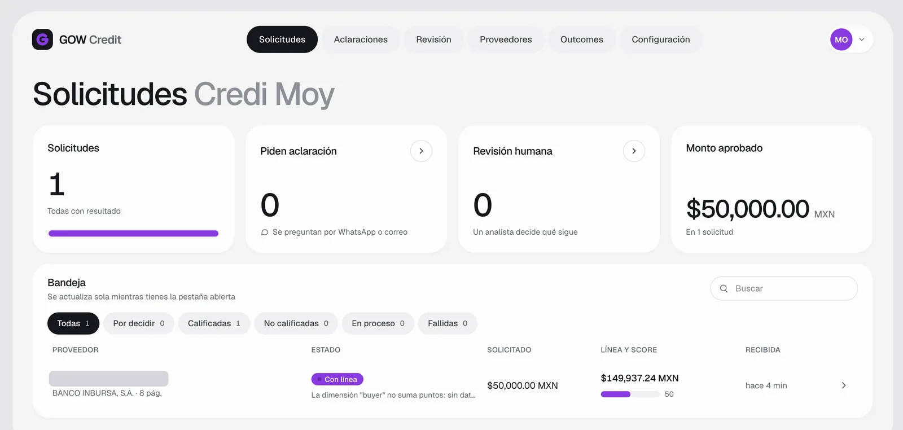<br><sub><b>Solicitudes</b>: la bandeja con estado, monto pedido, línea y score</sub></td><td width="50%">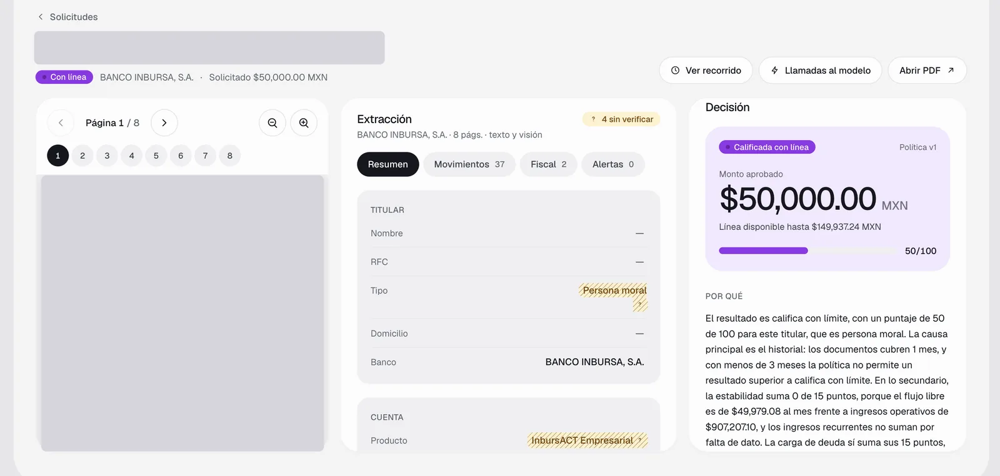<br><sub><b>Detalle</b>: el PDF, la extracción y la decisión con su explicación</sub></td></tr>
<tr><td width="50%">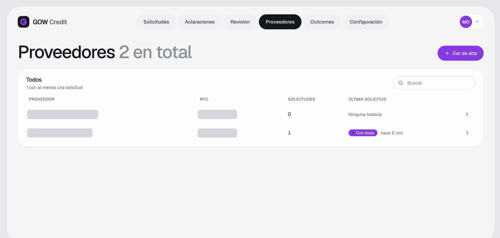<br><sub><b>Proveedores</b>: cada proveedor y su última solicitud</sub></td><td width="50%">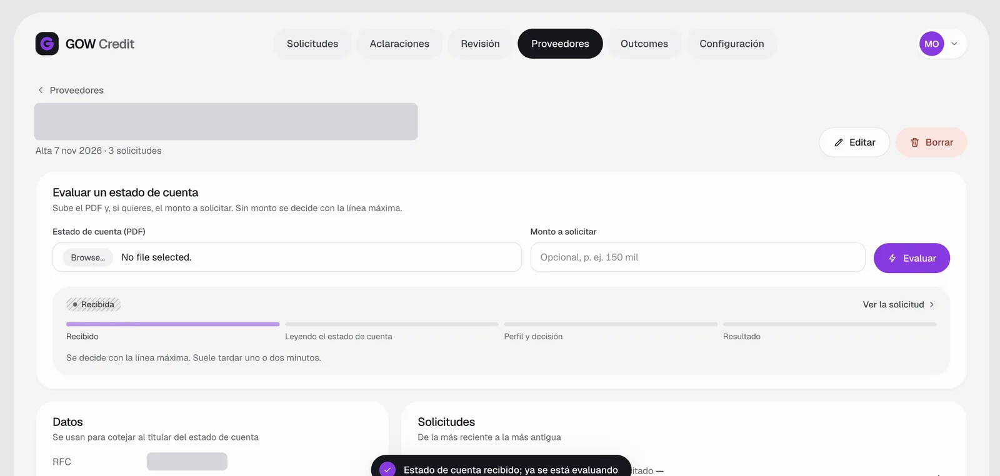<br><sub><b>Evaluar desde el proveedor</b>: se sube el PDF y el monto y se sigue el avance</sub></td></tr>
<tr><td width="50%">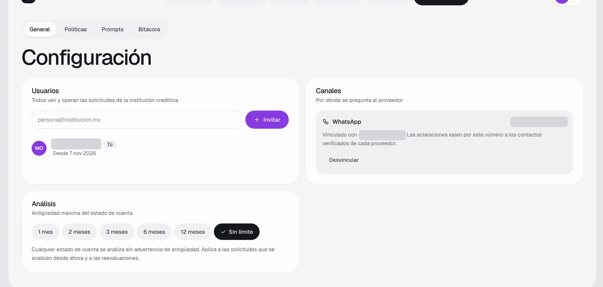<br><sub><b>Configuración</b>: usuarios, WhatsApp y antigüedad del estado de cuenta</sub></td><td width="50%">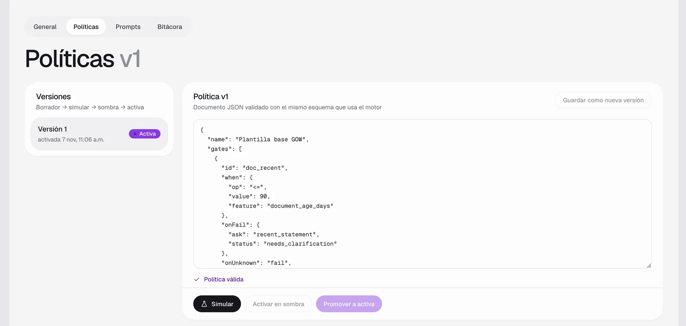<br><sub><b>Políticas</b>: JSON con versiones, simular, sombra, activar</sub></td></tr>
<tr><td width="50%">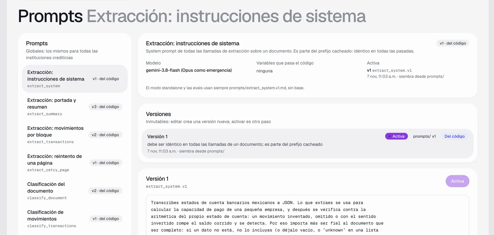<br><sub><b>Prompts</b>: versiones por prompt, sembradas desde <code>prompts/</code></sub></td><td width="50%">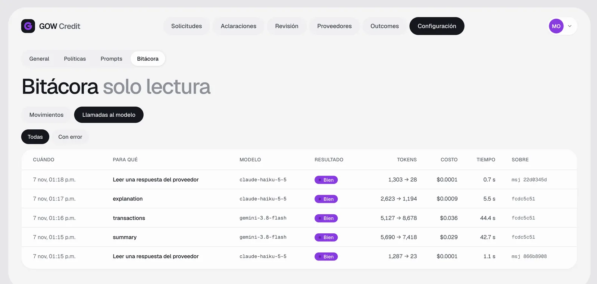<br><sub><b>Bitácora</b>: cada llamada al modelo con tokens, costo y tiempo</sub></td></tr>
</table>

<sub>En las capturas están tapados los nombres, RFC, correo, teléfono y la página del estado de cuenta.</sub>

## Cómo se decide el crédito

GOW Credit no presta. Le da a cada prestamista la infraestructura para aplicar **su** política, así
que la decisión vive en tres capas separadas.

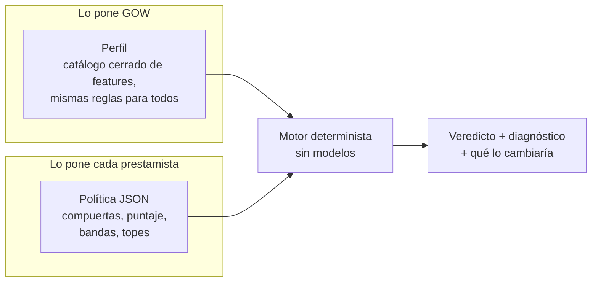

**Por qué esta forma.** Un "no" a secas no le sirve ni al proveedor ni al prestamista. El motor
devuelve el resultado, cada motivo detrás y **contrafactuales**: el cambio más pequeño que movería el
estado o la línea ("dos pagos más del comprador te llevarían a `qualified`"). Un rechazo se vuelve
un camino. Y como el motor es puro, la misma extracción, política y fecha siempre dan el mismo
veredicto.

### 1. Compuertas: lo que detiene una solicitud antes de puntuar

| Compuerta | Pasa cuando | Si no | Por qué |
|---|---|---|---|
| Estado de cuenta reciente | Cerró hace 90 días o menos | Pide uno más nuevo | Uno viejo no describe el flujo de hoy. El backoffice puede convertirlo en alerta en vez de bloqueo |
| Páginas completas | Trae todas las páginas que su propia paginación imprime | Pide las que faltan | Una página faltante puede esconder cargos |
| Integridad | Cuadra contra los saldos y totales del banco | `human_review` | Si no cuadra, falla la extracción o falla el documento |
| Sin señales de alerta | Sin sobregiro, cheque devuelto, embargo, orden judicial ni requerimiento fiscal | `human_review` | Señales de riesgo que una persona debe ver |
| Sin manipulación | Sin texto dirigido al sistema, sello fiscal consistente, sin páginas repetidas | `human_review` | Protege contra documentos alterados e instrucciones escondidas |
| Sin mora | Sin días de atraso en créditos vigentes con este prestamista | `not_qualified` | Estar atrasado hoy pesa más que cualquier puntaje |

### 2. Puntaje: cinco dimensiones, de 0 a 100

| Dimensión | Peso | Qué mide | 0 puntos en | Puntos completos en |
|---|---:|---|---|---|
| Capacidad | 35 | Ingreso operativo mensual contra el monto solicitado | 0.5× el monto | 3× el monto |
| Comprador | 25 | Pagos identificados del comprador (la cadena) | 0 pagos | 2 pagos |
| Estabilidad | 15 | Capacidad de pago: flujo libre / ingreso | 10 % | 50 % |
| Deuda | 15 | Servicio de deuda / ingreso (menos es mejor) | 40 % | 10 % |
| Recurrencia | 10 | Parte del ingreso que se repite | 20 % | 60 % |

**Por qué estos pesos.** El pronto pago se cobra del flujo del propio proveedor y, sobre todo, de la
factura que la cadena le debe. Por eso capacidad y comprador suman 60. El "ingreso operativo" deja
fuera los traspasos entre cuentas propias, los préstamos recibidos y los abonos dudosos: inflar el
ingreso con dinero propio es el truco más común en un estado de cuenta. Un dato con confianza menor a
0.7 no cuenta para el puntaje.

### 3. Bandas, topes y línea

| Puntaje | Estado | Línea de la banda |
|---|---|---|
| 70 o más | `qualified` | 50 % del ingreso operativo mensual |
| 50 a 69 | `qualified_with_limit` | 25 % del ingreso operativo mensual |
| Menos de 50 | `not_qualified` | — |

- **Tope.** Sin ningún pago del comprador, el mejor estado posible es `qualified_with_limit`. Los meses
  de historia ya no topan: la política dice cuántos se evalúan (ver abajo).
- **Línea final** = la menor entre la línea de la banda, la capacidad de deuda menos lo que el
  proveedor ya debe a este prestamista, y lo que queda del programa del comprador.
- **Aclaraciones.** Hasta 2 rondas. Solo se pregunta por abonos dudosos mayores al 30 % del ingreso
  del periodo que puedan cambiar el estado o la línea.

### 4. Uno o tres meses: lo elige la política

Cada prestamista decide en su política cuántos meses de estados de cuenta se evalúan, con un solo campo:
`"history": { "months": 1 }` o `"history": { "months": 3 }` ([ADR 0072](docs/adr/0072-evaluated-months-one-or-three.md)).

| | Un mes (por omisión) | Tres meses seguidos |
|---|---|---|
| Qué se evalúa | El mes más reciente. Si llegan más, los anteriores quedan fuera del cálculo | Los tres meses más recientes. Si llegan más, se toman esos tres |
| Si llega menos | No aplica | Pide los meses que faltan (`additional_months`) en vez de decidir |
| Meses seguidos | No aplica | Obligatorio: un hueco (julio y septiembre sin agosto) cuenta como si faltara |
| Cómo pueden llegar | Un PDF | Tres PDF, un PDF con un periodo de tres meses (Mercado Pago) o un PDF con tres estados de cuenta pegados |
| Por WhatsApp | Un PDF abre la solicitud y se analiza al momento | Se piden los tres PDF **juntos, en un solo envío**. WhatsApp los entrega como mensajes separados: el primero abre la solicitud y el análisis espera 60 s; los que llegan en esa ventana se suman a la misma solicitud |

Las políticas vienen en pares que solo difieren en ese campo:

| Modo | Un mes | Tres meses |
|---|---|---|
| Standalone (`pnpm run evaluate`) | [`policies/examples/standalone-evaluation.v1.json`](policies/examples/standalone-evaluation.v1.json) (por omisión) | [`policies/examples/standalone-tres-meses.v1.json`](policies/examples/standalone-tres-meses.v1.json) |
| Full (backoffice) | [`policies/gow-base.v1.json`](policies/gow-base.v1.json) (la que se clona al crear el prestamista) | [`policies/examples/gow-base-tres-meses.v1.json`](policies/examples/gow-base-tres-meses.v1.json) |

Lo que revisa el documento completo no se recorta al mes evaluado: las señales de manipulación, las
páginas faltantes y el cotejo de comisiones contra el CFDI miran todos los PDF y todos sus movimientos.

<details>
<summary><b>Cómo probar los dos modos</b></summary>

<br/>

**Sin gastar (pruebas y escenarios):**

```bash
pnpm vitest run packages/decision/src/policies.test.ts packages/decision/src/engine/evaluate.test.ts
```

```bash
pnpm scenario run proveedor-nuevo-un-mes proveedor-tres-meses tres-meses-falta-uno
```

El primer escenario es un mes con la política de un mes (`qualified`); el segundo, tres meses con la de
tres (`qualified`, tendencia de ingresos incluida); el tercero, dos meses con la de tres
(`needs_clarification`, pide los que faltan).

**Standalone con PDFs.** Cada PDF suelto es una solicitud; una **subcarpeta** es una solicitud con todos
sus PDF, como si llegaran juntos:

```text
mis-estados/
├── un-mes.pdf              → solicitud "un-mes"
├── mercado-pago-3-meses.pdf → solicitud "mercado-pago-3-meses" (un PDF, tres meses)
└── proveedor-a/            → solicitud "proveedor-a" con sus tres PDF
    ├── 2026-08.pdf
    ├── 2026-09.pdf
    └── 2026-10.pdf
```

Con un mes (por omisión):

```bash
pnpm run evaluate mis-estados
```

Con tres meses:

```bash
pnpm run evaluate mis-estados --policy policies/examples/standalone-tres-meses.v1.json --out data/out/tres-meses
```

En `data/out/.../<id>.md`, la sección del perfil muestra `months_of_history` y la nota de qué periodos
entraron o se recortaron. Con la política de tres meses, `un-mes` queda en `needs_clarification` con la
pregunta de los meses que faltan; se contesta con `--answers` poniendo las rutas de los PDF en `paths`.

**Full (backoffice y WhatsApp).** En **Configuración → Políticas**, copia el JSON de
`policies/examples/gow-base-tres-meses.v1.json` (o cambia `"history": { "months": 1 }` a `3` en la
versión activa), guárdalo como borrador, simúlalo y actívalo. Para volver, activa otra vez la versión de
un mes. Luego, desde el teléfono del proveedor:

1. Manda un solo PDF: el bot contesta que lo recibió y, al minuto, pide los dos meses que faltan,
   con su mes de corte, para mandarlos juntos.
2. Selecciona los otros dos PDF y mándalos en un solo envío: el primero contesta la pregunta, el segundo
   responde "lo reviso junto con los que ya mandaste" y un minuto después llega el resultado con los tres
   meses.
3. O desde el inicio, manda los tres PDF juntos: es una sola solicitud.
4. Sin teléfono: en el detalle del proveedor, **Evaluar estados de cuenta** acepta los tres PDF a la vez
   (o uno solo que traiga los tres meses) y los evalúa juntos.

</details>

## Qué se puede configurar

| Dónde | Qué | Valores |
|---|---|---|
| Backoffice → Configuración → General | Antigüedad máxima del estado de cuenta | 1, 2, 3 (por defecto), 6 o 12 meses, o sin límite. Fuera del límite la solicitud lleva una alerta, no se bloquea |
| Backoffice → Configuración → General | Número de WhatsApp | Vincular, desvincular o cambiar escaneando un QR |
| Backoffice → Configuración → General | Usuarios | Invitar o quitar personas; todas ven y operan las solicitudes del prestamista |
| Backoffice → Configuración → Políticas | Meses que se evalúan | `"history": { "months": 1 }` (por omisión) o `3`, seguidos. Ver [Uno o tres meses](#4-uno-o-tres-meses-lo-elige-la-política) |
| Backoffice → Configuración → Políticas | **La política completa** | Un borrador JSON validado con el mismo esquema del motor. Antes de activarlo, se **simula** contra solicitudes reales: cuántas mejoran, empeoran o cambian de línea, y la mora observada. Cada versión queda guardada |
| Backoffice → Configuración → Prompts | Los prompts de los modelos | Editar crea una versión nueva y activarla es otro paso; las versiones se pueden comparar. Son los mismos para todos los prestamistas |
| `.env` | Llaves de modelos y correo | Ver [Qué necesitas](#qué-necesitas) |
| `.env` | `LLM_CACHE_MODE` | `readwrite` (por defecto) o `read`: con `read` nunca se llama a un modelo y repetir cuesta cero |
| `.env` | `WORKER_MODEL_CONCURRENCY` | Llamadas a modelos en paralelo (por defecto 3) |
| `.env` | `WHATSAPP_SELF_REGISTRATION` | `true` (por defecto) o `false` |
| `.env` | `SETUP_PASSWORD` | Con ella, el wizard del primer inicio pide esa contraseña antes de crear la institución (demo compartida). Sin ella, la crea quien abra la página primero |
| `.env` | `GOW_TIME_ZONE` | Zona del calendario de negocio (por defecto `America/Mexico_City`) |
| Al levantar | `GOW_WEB_PORT`, `GOW_API_PORT` | Puertos del backoffice y la API |

<details>
<summary><b>Qué trae una política</b></summary>

<br/>

La plantilla base está en [`policies/gow-base.v1.json`](policies/gow-base.v1.json) y su esquema en
[`docs/schema/policy.schema.json`](docs/schema/policy.schema.json).

| Campo | Define |
|---|---|
| `history.months` | Meses que se evalúan: 1 (el más reciente) o 3 (los tres más recientes, seguidos) |
| `gates[]` | Compuertas: `feature`, operador, valor, qué pasa si falla (`onFail`) y si el dato falta (`onUnknown`) |
| `score.dimensions[]` | Dimensiones con `weight`, `zeroAt`, `fullAt`, `relativeTo` e `inverse` |
| `score.minConfidence` | Confianza mínima para que un dato cuente |
| `decision.bands[]` | Puntaje mínimo, estado y línea (`pctOf` de una feature) |
| `decision.caps[]` | Condiciones que limitan el mejor estado posible |
| `decision.limitFormula` | Cómo se combina la línea final |
| `clarification` | Rondas máximas y desde qué tamaño de abono se pregunta |

Una política solo puede usar features del catálogo cerrado; si nombra una que no existe, no valida.

</details>

## Arquitectura

Cuatro procesos, una base, y ningún proceso llama directamente a otro.


Una sola imagen corre la API, el worker y WhatsApp; la variable `APP` elige cuál. Los procesos se
coordinan solo por la base (cola, buzón de salida y estados), así que cualquiera puede reiniciarse sin
perder trabajo. Cada uno se conecta con su propio rol de Postgres, y la seguridad por fila está
forzada en todas las tablas de negocio: un error en un proceso no puede leer datos de otro
prestamista.

**El recorrido de un PDF.** WhatsApp lo guarda y abre una solicitud → la cola le entrega el trabajo al
worker → el workflow extrae, verifica, arma el perfil y decide → si hay preguntas, el workflow se
**suspende** y la pregunta sale por el buzón → la respuesta del proveedor **reanuda** el workflow, que
decide → el veredicto sale por WhatsApp.

### Por qué cada pieza

| Pieza | Para qué | Por qué esta |
|---|---|---|
| **Gemini 3.8 Flash** | Leer el estado de cuenta | En los 9 estados de cuenta de desarrollo empató con Claude Opus (1,513 de 1,513 movimientos, 9 de 9 cuadran) a una quinta parte del costo: USD 1.80 contra 9.16. Recibe el PDF completo y el esquema de salida, con caché implícita |
| **Claude Opus 5.5** | Emergencia y relecturas | Si Google se cae, Opus rehace el documento. Si un bloque no cuadra, Opus lo relee. La doble lectura del encabezado usa la otra familia de modelos, para que dos errores iguales sean improbables |
| **Claude Haiku 5.5** | Mensajes y respuestas del proveedor | Redacta las preguntas en lenguaje simple y lee las respuestas que las reglas no entienden, siempre eligiendo entre opciones cerradas. Rápido y barato para textos cortos |
| **Jev** (TypeSafe AI) | Clasificar documentos y movimientos ambiguos | Da probabilidades calibradas por pregunta, no solo una etiqueta, que es lo que hace falta para decidir *cuándo preguntar*. 32 de 33 en la eval del clasificador, unos USD 0.015 por cada 1,000 movimientos. Las reglas van primero y Jev solo ve lo que no resuelven; sin llave, Haiku toma su lugar |
| **Mastra** | Orquestar el workflow | El problema es un pipeline con una pausa que puede durar días: esperar al proveedor. Mastra da `suspend()` y `resume()` persistidos en Postgres, salida estructurada y trazas. La alternativa era escribir a mano una máquina de estados. Donde Mastra oculta algo que hay que medir, el código baja al SDK |
| **Supabase** | Base, acceso y archivos | Postgres con **RLS forzada** por prestamista (filtrar datos entre prestamistas es el peor incidente posible), Auth para los enlaces de acceso y Storage, en un solo servicio. En local corre autohospedado con los mismos roles que en producción |
| **pg-boss** | Cola de trabajos | Leer un PDF largo toma minutos. pg-boss vive en el mismo Postgres (sin otro broker), con reintentos, cola de fallidos y llave de idempotencia por hash del documento: un PDF repetido nunca se paga dos veces |
| **Baileys** | WhatsApp | Vincula un número normal con un QR, sin aprobar plantillas con Meta. Bien para una demo; producción usaría la API oficial detrás de la misma interfaz |
| **Zod** | Contratos | Una sola fuente de verdad: los tipos, la validación de la API y el JSON Schema de `docs/schema/` salen del mismo esquema |
| **Drizzle** | Acceso a datos | SQL primero, con las políticas RLS en el esquema y migraciones versionadas |
| **React + Vite** | Backoffice | Una app estática que solo habla con `/bo/v1`; en producción va en un CDN |

## La demo en Railway

La demo existe para que una persona sin perfil técnico entre con su correo y opere una solicitud.
Corre la misma imagen y el mismo código que la pila local, acomodados un poco distinto para encajar
en el modelo de Railway: un proyecto de Supabase gestionado para Postgres y Auth, y tres servicios en
Railway.

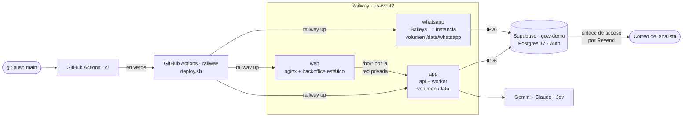

| Servicio | Qué corre | Por qué tiene esta forma |
|---|---|---|
| `app` | La API y el worker en un contenedor, arrancados por `app-start.sh`. Dominio público | Un volumen de Railway se monta en un solo servicio, y la API y el worker necesitan los dos el disco de documentos (`/data`). Si cualquiera de los dos procesos muere, el contenedor termina y Railway lo reinicia |
| `web` | El backoffice estático detrás de nginx, construido con `web.Dockerfile`. Dominio público: el que abre la gente | nginx reenvía `/bo/*` a `app` por la red privada de Railway, así la cookie de sesión queda en el mismo origen. Resuelve `app.railway.internal` en cada petición y arranca aunque `app` todavía no exista |
| `whatsapp` | `APP=whatsapp`, exactamente una instancia. Sin dominio público | Dos sesiones de Baileys con el mismo número se expulsan entre sí. Su sesión vive en un volumen, así que un reinicio no vuelve a pedir el QR |
| Supabase `gow-demo` | Postgres 17 con los mismos roles y RLS que en local, y Auth mandando los enlaces de acceso por Resend | Solo Supabase Auth manda los enlaces por correo que usa el backoffice, y un proyecto gestionado es el único al que llegan los servicios de Railway |

**Cómo un push se convierte en la demo que corre**

1. Haces push a `main`. Corre el workflow `ci`: typecheck, lint, pruebas, escenarios, evals, builds.
2. Si CI queda en verde, el workflow [`railway`](.github/workflows/railway.yml) descarga **ese mismo
   commit** y corre `infra/railway/deploy.sh`. Con CI en rojo no se despliega nada. Como el
   repositorio es público, solo despliega un CI que vino de un push o de un disparo manual en este
   mismo repositorio: el PR de un fork, aunque su rama se llame `main`, nunca llega a usar el token.
3. `deploy.sh` manda el commit con `git archive`, nunca la carpeta de trabajo, así que `data/`,
   `.env` y cualquier cambio sin commit se quedan fuera. Llama a `railway up` una vez por servicio,
   `app` primero.
4. Railway construye cada imagen con el `Dockerfile` del repositorio (`web` con
   `infra/railway/web.Dockerfile`). Antes de que el contenedor nuevo de `app` reciba tráfico, su
   **pre-deploy** les pone contraseña a los roles de la base y corre las migraciones; el contenedor
   entra en servicio solo cuando `/healthz` responde, y entonces se retira el anterior. `web` y
   `whatsapp` simplemente se reinician con su imagen nueva.
5. Un trabajo que iba a medias cuando el worker se reinició lo reintenta la cola, y la sesión de
   WhatsApp sobrevive en su volumen.

El mismo despliegue se lanza desde una laptop con `sh infra/railway/deploy.sh [ref] [servicios]`,
después de `railway link`. El workflow solo necesita un secreto en GitHub, `RAILWAY_TOKEN`, un token
de proyecto del entorno `production`. Las llaves de los modelos, las contraseñas de la base y las
llaves de Supabase nunca pasan por GitHub: viven en las variables de Railway de cada servicio, y
`set-db-passwords.sh` genera una contraseña por rol de base sin imprimirla nunca.

**Qué cambia frente al plan de producción, a propósito**

| | Demo en Railway | Plan en Cloud Run |
|---|---|---|
| API y worker | Un contenedor, un volumen | Dos servicios que escalan por separado |
| Backoffice | nginx en Railway, proxy hacia `app` | CDN de Vercel con un rewrite de `/bo/*` |
| Sesión de WhatsApp | Guardada en un volumen | Se pierde al reiniciar (hueco abierto) |
| Secretos | Variables de Railway | Secret Manager, un juego por servicio |
| Migraciones | Pre-deploy de `app` | Un job `migrate` antes de cualquier servicio |
| Disparador | Push a `main` con CI en verde | A mano, con aprobación en `production` |
| TLS hacia Postgres | Sin verificar el certificado | Verificado |

Los pasos de configuración, las variables y el ajuste de Supabase Auth están en
[`docs/deploy.md`](docs/deploy.md), en "Demo en Railway".

## Precisión y cómo se vigila al modelo

La extracción es la métrica que más importa, y un modelo puede inventar. Por eso el sistema no le cree
al modelo: lo **verifica**.

| En los 9 estados de cuenta de desarrollo | Gemini 3.8 Flash | Claude Opus 5.5 |
|---|---|---|
| Movimientos extraídos | 1,513 / 1,513 | 1,513 / 1,513 |
| Inventados / omitidos | 0 / 0 | 0 / 0 |
| Encabezado y resumen | 120 / 120 campos | 120 / 120 campos |
| CFDI | 104 / 107 campos | 106 / 107 campos |
| Estados de cuenta que cuadran | 9 / 9 | 9 / 9 |
| Costo de los 9 | USD 1.80 | USD 9.16 |

El ground truth sale de un parser determinista por banco sobre la capa de texto del PDF, arbitrado por
la aritmética del banco, y nunca del modelo que se mide.

**Qué protege en documentos que el sistema nunca vio**

- **Citas.** Cada valor trae su página y su fragmento. Un valor sin cita queda como no verificado.
- **La aritmética del banco como ancla.** Inicial + abonos − cargos = final, totales y conteos
  impresos, y el saldo corrido renglón por renglón. Un error del modelo casi siempre rompe una de esas
  sumas.
- **Relectura dirigida.** Lo que no cuadra se relee solo en su página; si sigue sin cuadrar, se marca y
  el motor lo ve.
- **Doble lectura** del encabezado con la otra familia de modelos. Si no coinciden, se pregunta.
- **Validadores**: dígito de control de la CLABE, estructura del RFC, fechas dentro del periodo,
  cruces con el CFDI.
- **Inyección de instrucciones.** El texto del PDF es dato, nunca instrucción. Una eval con PDFs
  adversarios corre en CI y tiene que pasar al 100 %.
- **Lo que no se puede verificar va marcado**, y si puede cambiar el resultado, se le pregunta al
  proveedor.

**Reproducibilidad.** Cada respuesta de un modelo se guarda con una llave que incluye el modelo, el
prompt, el esquema y el hash del documento, así que repetir con `LLM_CACHE_MODE=read` da exactamente
la misma salida y no cuesta nada. Los modelos, los prompts y las dependencias están fijados. Una
llamada nueva a un modelo no es determinista, pero toda extracción pasa por el mismo contrato, los
mismos validadores y el mismo cuadre; una diferencia entre dos lecturas aparece como alerta o
pregunta, nunca en silencio.

## CI/CD y el camino a producción

| Workflow | Cuándo corre | Qué hace |
|---|---|---|
| [`ci.yml`](.github/workflows/ci.yml) | Cada push a `main` y cada PR | Typecheck estricto, lint (incluye tamaño, complejidad y duplicados), pruebas unitarias, escenarios de punta a punta con Postgres 17, evals de inyección y del clasificador sin llaves, build del backoffice, imágenes de la API y el worker, gitleaks y osv-scanner |
| [`eval-extraction.yml`](.github/workflows/eval-extraction.yml) | PRs que tocan prompts, extracción, modelos o contratos | Extracción contra el ground truth con umbral por banco. Restaura los datos privados desde un paquete cifrado y falla si una métrica baja del umbral |
| [`railway.yml`](.github/workflows/railway.yml) | Después de un `ci` en verde sobre `main` | Manda ese commit a los tres servicios de Railway con `deploy.sh`. Ver [La demo en Railway](#la-demo-en-railway) |
| [`deploy.yml`](.github/workflows/deploy.yml) | Solo a mano, por entorno (`staging` o `production`) | Imágenes → migración → servicios en Cloud Run, y el backoffice en Vercel. Sin llaves JSON: identidad federada de GitHub a Google, y `production` pide aprobación |

Producción en Google Cloud está diseñada y el pipeline escrito, pero nunca ha corrido: el worksample
no creó cuentas en la nube. La forma es la que la demo aproxima, con cada proceso escalando por su
cuenta.

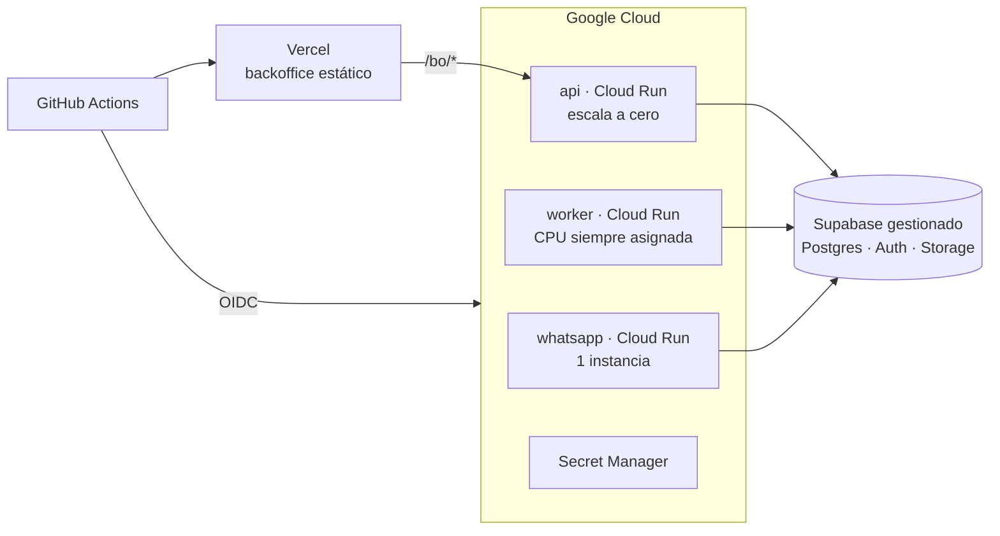

Regiones, parámetros, secretos, costos de operación y lo que falta están en
[`docs/deploy.md`](docs/deploy.md).

## Límites conocidos

- **Producción no está desplegada.** La demo en Railway corre; el pipeline de Cloud Run está listo pero
  nunca se ha ejecutado.
- **La demo toma atajos.** El TLS hacia Supabase no verifica el certificado, la API y el worker
  escalan juntos, y el autorregistro por WhatsApp está encendido.
- **WhatsApp por Baileys**, no por la API oficial de Meta: sirve para una demo, no para producción.
- **Todavía sin SAT ni buró.** El perfil está diseñado para recibirlos como señales nuevas sin cambiar
  el motor, pero no están conectados.
- **Documentos en disco.** Supabase Storage corre, pero su adaptador no está conectado; los PDFs viven
  en un volumen.
- **Los datos de desarrollo se quedan fuera del repositorio.** Estados de cuenta, ground truth y caché
  nunca se versionan.

## Mapa del repositorio

| Carpeta | Qué hay |
|---|---|
| `apps/api` | API HTTP: backoffice, solicitudes, aclaraciones, políticas, asistente inicial |
| `apps/worker` | Cola y workflow: extracción, decisión, mensajes salientes |
| `apps/whatsapp` | Canal de WhatsApp (Baileys) |
| `apps/web` | Backoffice (React 19 + Vite) |
| `packages/contracts` | Contratos Zod: extracción, perfil, política, veredicto, solicitud |
| `packages/extraction` | Ruteo de modelos, pasadas, validadores, cuadre, bloque fiscal |
| `packages/llm` | Modelos y precios, cliente estructurado, caché de respuestas, clasificadores |
| `packages/decision` | Perfil, motor de políticas, contrafactuales y simulación |
| `packages/mastra` | El workflow `processApplication` |
| `packages/db`, `packages/platform`, `packages/channels` | Base con RLS, cola y almacenamiento, conversación de WhatsApp |
| `policies/` | Plantilla base de política |
| `prompts/` | Prompts versionados y su changelog |
| `evals/`, `scenarios/` | Evals de extracción e inyección; escenarios de punta a punta |
| `infra/railway/` | La demo: configuración de servicios, despliegue, nginx, pre-deploy, Supabase Auth |
| `infra/`, `scripts/` | Supabase local, nginx del backoffice, `stack.sh` |
| `docs/` | Diseño (`00` a `09`), esquemas, despliegue |
