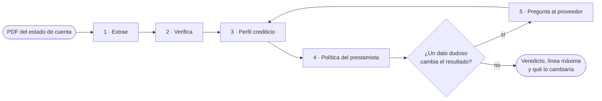
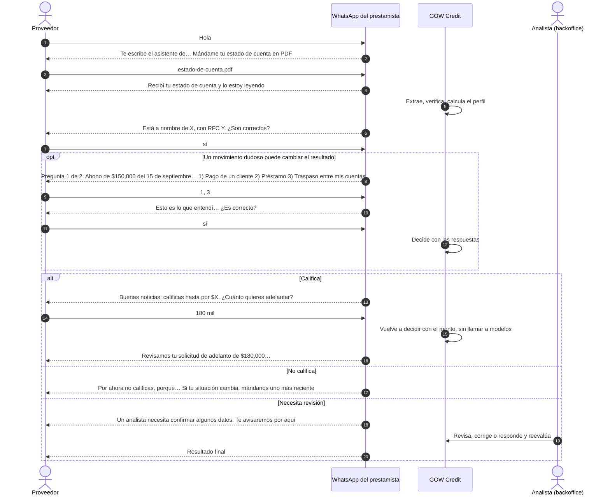
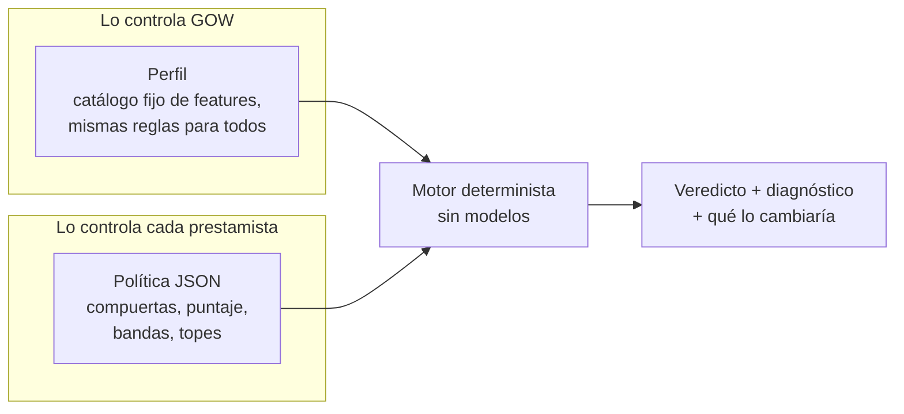
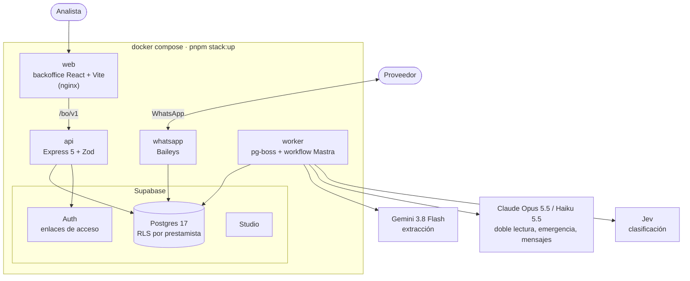
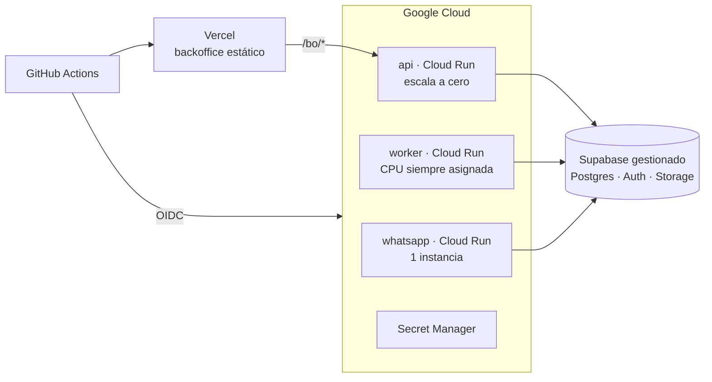

<div align="center">

# GOW Credit

**Diagnóstico crediticio sobre estados de cuenta bancarios, por WhatsApp.**

Un proveedor manda su estado de cuenta en PDF y, en minutos, sabe hasta cuánto le pueden adelantar
del pago de sus facturas. Si un dato dudoso puede cambiar el resultado, el sistema le pregunta antes
de decidir.

[](https://github.com/moydany/gow-credit/actions/workflows/ci.yml)

| 1,513 / 1,513 | 0 | 9 / 9 | USD 0.20 |
|:---:|:---:|:---:|:---:|
| movimientos extraídos | inventados u omitidos | estados de cuenta que cuadran | por documento |

<sub>Sobre los 9 estados de cuenta de desarrollo, con Gemini 3.8 Flash.</sub>

</div>

---

## Contenido

- [Para quien evalúa](#para-quien-evalúa)
- [Qué hace](#qué-hace)
- [Requisitos](#requisitos)
- [Levantarlo con Docker Compose](#levantarlo-con-docker-compose)
- [Configuración inicial](#configuración-inicial)
- [Cómo opera la demo](#cómo-opera-la-demo)
- [Cómo se decide el crédito](#cómo-se-decide-el-crédito)
- [Qué se puede configurar](#qué-se-puede-configurar)
- [Arquitectura](#arquitectura)
- [Precisión y control de errores del modelo](#precisión-y-control-de-errores-del-modelo)
- [CI/CD y despliegue](#cicd-y-despliegue)
- [Límites y pendientes](#límites-y-pendientes)
- [Estructura del repositorio](#estructura-del-repositorio)
- [English summary](#english-summary)

## Para quien evalúa

| Entregable | Dónde |
|---|---|
| Código y cómo correrlo | Este README, [Levantarlo con Docker Compose](#levantarlo-con-docker-compose) |
| Lo que entendimos, supuestos y alcance | [`docs/00-spec.md`](docs/00-spec.md) |
| Decisiones de diseño y por qué | [Arquitectura](#arquitectura), [Cómo se decide el crédito](#cómo-se-decide-el-crédito) y el diseño completo en `docs/01` a `docs/09` |
| Prompts | [`prompts/`](prompts/), versionados, con su [changelog](prompts/CHANGELOG.md) |
| Contratos de datos | [`docs/schema/`](docs/schema/): JSON Schema generado desde Zod |
| CI/CD | [`.github/workflows/`](.github/workflows/) y [CI/CD y despliegue](#cicd-y-despliegue) |
| Plan de despliegue | [`docs/deploy.md`](docs/deploy.md): Cloud Run, Supabase y Vercel |

## Qué hace



1. **Extrae** encabezado, resumen, movimientos y el CFDI que timbra el banco. Cada valor trae la
   página y el fragmento de donde salió.
2. **Verifica** la extracción contra la aritmética del propio banco: saldo inicial más abonos menos
   cargos igual a saldo final, totales y conteos impresos, saldo corrido, CLABE, RFC y fechas. Lo que
   no cuadra se relee página por página.
3. **Calcula un perfil**: ingresos operativos, capacidad de pago, servicio de deuda, recurrencia,
   pagos del comprador, alertas.
4. **Aplica la política del prestamista** (el tenant) con un motor determinista. Ningún modelo decide.
5. **Pregunta al proveedor** por WhatsApp cuando un movimiento ambiguo puede cambiar el resultado.
   Con su respuesta, decide.

Cada solicitud termina en uno de seis estados:

| Estado | Significa |
|---|---|
| `qualified` | Califica con la línea completa de su banda |
| `qualified_with_limit` | Califica con una línea menor o con tope |
| `not_qualified` | No califica; el diagnóstico dice qué lo cambiaría |
| `needs_clarification` | Falta una respuesta del proveedor antes de decidir |
| `human_review` | Un analista confirma antes de responder |
| `failed` | No se pudo leer el documento; el motivo queda registrado |

## Requisitos

| Necesitas | Para qué |
|---|---|
| **Docker** con **Docker Compose v2** (Docker Desktop en Mac o Windows) | Todo corre en contenedores. Compose necesita soportar `--wait` |
| **Node 24+** y **pnpm** (`corepack enable`) | Solo para lanzar `pnpm stack:up` y generar los secretos locales la primera vez. No hace falta `pnpm install` |
| Unos **8 GB de disco** libres | Las imágenes de Supabase (unos 6.5 GB) y la imagen de la app |
| Puertos libres en `127.0.0.1` | `5173` (backoffice), `3000` (API), `54340` a `54343` (Postgres, gateway, Studio, correo) |
| **`ANTHROPIC_API_KEY`** (obligatoria) | Doble lectura, extracción de emergencia, clasificación de respaldo y redacción de mensajes |
| **`GEMINI_API_KEY`** (recomendada) | Extracción con Gemini 3.8 Flash. Sin ella extrae Claude Opus 5.5, unas 5 veces más caro |
| `TYPESAFE_API_KEY` (opcional) | Clasificación con Jev. Sin ella clasifica Claude Haiku 5.5 |
| `RESEND_API_KEY` y `RESEND_FROM` (opcional) | Correos de acceso al backoffice por Resend. Sin ellas llegan al buzón local |
| Un **teléfono con WhatsApp** | Para vincular el número del prestamista escaneando un QR. Conviene un número de prueba |

## Levantarlo con Docker Compose

```bash
git clone https://github.com/moydany/gow-credit.git
```

```bash
cd gow-credit
```

```bash
cp .env.example .env
```

Abre `.env` y pon al menos `ANTHROPIC_API_KEY` y `GEMINI_API_KEY`. Después:

```bash
pnpm stack:up
```

La primera vez genera los secretos de desarrollo, descarga Supabase y construye la imagen de la app;
tarda varios minutos. Termina cuando todos los servicios están sanos e imprime las direcciones:

| Dirección | Qué es |
|---|---|
| http://127.0.0.1:5173 | **Backoffice**. La primera vez abre el asistente de configuración |
| http://127.0.0.1:3000 | API |
| http://127.0.0.1:54342 | Supabase Studio, para ver la base |
| http://127.0.0.1:54343 | Buzón local con los correos de acceso |

| Comando | Qué hace |
|---|---|
| `pnpm stack:up` | Genera los secretos si faltan, construye y levanta todo |
| `pnpm stack:ps` | Estado de cada servicio |
| `pnpm stack:logs` | Registros de la API, el worker y WhatsApp |
| `pnpm stack:down` | Detiene todo y conserva los datos |
| `pnpm stack:reset` | Detiene y borra la base, la sesión de WhatsApp y los documentos |

> [!TIP]
> Si los puertos 5173 o 3000 están ocupados: `GOW_WEB_PORT=8080 GOW_API_PORT=3100 pnpm stack:up`.

> [!NOTE]
> Todo escucha solo en `127.0.0.1`. Los secretos que genera `pnpm stack:up` son de desarrollo y
> viven en `infra/supabase/.env`, fuera de git.

## Configuración inicial

Con el sistema vacío, el backoffice abre un asistente de dos pasos. No hace falta la terminal.

1. **Cuenta.** Escribe el nombre del prestamista y el correo del administrador. Se crean el
   prestamista, su política base activa y el administrador, y entras directo con una sesión de 8 h.
2. **WhatsApp.** Aparece un QR. En el teléfono: *WhatsApp → Dispositivos vinculados → Vincular un
   dispositivo* y escanéalo. En unos segundos el backoffice muestra el número vinculado. Puedes
   *Omitir por ahora* y vincularlo después en **Configuración → General → Canales**; mientras tanto, las
   aclaraciones se responden a mano desde el backoffice.

Después, desde **Configuración**:

- **Usuarios**: invitar a más personas. Les llega un enlace de acceso por correo (al buzón local en
  `:54343` si no configuraste Resend).
- **Volver a entrar**: en `/entrar`, escribe tu correo y abre el enlace que llega.

## Cómo opera la demo

El prestamista vincula su número; los proveedores le escriben a ese número. Cualquier número
desconocido puede registrarse mandando su estado de cuenta (se apaga con
`WHATSAPP_SELF_REGISTRATION=false`).



**Lo que hace el bot en cada paso:**

- **Registro.** Lee el titular y el RFC del estado de cuenta y pide confirmarlos. Si no son
  correctos, pide nombre y RFC; si el RFC es de persona moral, también el representante legal. El RFC
  que escribe tiene que empezar como la raíz impresa.
- **Documentos que no sirven.** Un PDF con contraseña, un escaneo ilegible, algo que no es estado de
  cuenta o varios estados de cuenta en un PDF reciben una respuesta concreta, y el bot vuelve a
  esperar un PDF.
- **Preguntas.** Una a la vez, con opciones numeradas. Acepta varias respuestas en un mensaje
  (`1, 3`), correcciones libres ("me equivoqué, la 2 era préstamo") y "no sé". Antes de evaluar
  muestra un resumen para confirmar. Lo que no entiende con reglas lo interpreta Claude Haiku, pero
  solo eligiendo entre las opciones; nunca inventa una respuesta.
- **Monto.** Primero ofrece la línea máxima y luego pregunta cuánto quiere adelantar ("180000",
  "180 mil", "1.2 millones" u "omitir"). Más que la línea se repregunta.
- **Lo que nunca sale por el chat:** saldos, CLABE, ni los motivos internos del motor.

**En el backoffice** (http://127.0.0.1:5173):

| Pantalla | Para qué |
|---|---|
| Solicitudes | Cada solicitud con su estado, línea y alertas |
| Detalle | El PDF junto a la extracción: un clic en un valor salta a su página y fragmento. Perfil, veredicto con diagnóstico completo y contrafactuales |
| Recorrido | La solicitud paso a paso en 3D: mensajes, lecturas, llamadas a modelos y decisiones |
| Aclaraciones | Preguntas pendientes; se responden a mano si el proveedor no tiene WhatsApp |
| Revisión | Correcciones del analista sobre la extracción; se guardan como pares inmutables y reevalúan |
| Proveedores | Alta, búsqueda y baja de proveedores con todo lo suyo |
| Outcomes | Si cada crédito se pagó o cayó en mora, para medir la política |
| Bitácora | Quién hizo qué, y cada llamada a un modelo con su costo |
| Configuración | General (antigüedad del estado de cuenta, WhatsApp, usuarios), Políticas y Prompts |

## Cómo se decide el crédito

GOW Credit no presta: da la infraestructura para que cada prestamista aplique **su** política. Por
eso la decisión está separada en tres capas.



**¿Por qué así?** Un "no" sin explicación no le sirve al proveedor ni al prestamista. El motor da
el resultado, cada razón y los **contrafactuales**: el cambio mínimo que movería el estado o la línea
("con dos pagos más del comprador pasarías a `qualified`"). Es el "motor de segunda oportunidad": un
rechazo se convierte en un camino. Y como el motor es puro, la misma extracción, la misma política y
la misma fecha dan siempre el mismo veredicto.

### 1. Compuertas: lo que detiene antes de puntuar

| Compuerta | Pasa si | Si no pasa | Por qué |
|---|---|---|---|
| Documento reciente | El corte tiene 90 días o menos | Pide uno reciente | Un estado de cuenta viejo no describe el flujo actual. En el backoffice se cambia por una alerta que no bloquea |
| Páginas completas | Trae todas las páginas que imprime su paginación | Pide las que faltan | Una página omitida puede esconder cargos |
| Integridad | Cuadra contra los saldos y totales del banco | `human_review` | Si no cuadra, la extracción o el documento tienen un problema |
| Sin alertas | No hay sobregiro, cheque devuelto, embargo, orden judicial ni requerimiento fiscal | `human_review` | Son señales de riesgo que un analista debe ver |
| Sin manipulación | Ningún texto dirigido al sistema, cadena fiscal coherente, sin páginas repetidas | `human_review` | Protege contra documentos alterados o instrucciones escondidas |
| Sin atraso | Sin días de atraso en créditos vigentes con este prestamista | `not_qualified` | Un atraso actual pesa más que cualquier puntaje |

### 2. Puntaje: cinco dimensiones, de 0 a 100

| Dimensión | Peso | Qué mide | 0 puntos | Completo |
|---|---:|---|---|---|
| Capacidad | 35 | Ingreso operativo mensual frente al monto pedido | 0.5× el monto | 3× el monto |
| Comprador | 25 | Pagos identificados del comprador (la cadena) | 0 pagos | 2 pagos |
| Estabilidad | 15 | Capacidad de pago: flujo libre / ingresos | 10 % | 50 % |
| Deuda | 15 | Servicio de deuda / ingresos (menos es mejor) | 40 % | 10 % |
| Recurrencia | 10 | Parte de los ingresos que se repite | 20 % | 60 % |

**¿Por qué estos pesos?** El pronto pago se paga con el flujo del propio proveedor y, sobre todo,
con la factura que le debe la cadena. Por eso capacidad y comprador suman 60. Los "ingresos
operativos" excluyen traspasos entre cuentas propias, préstamos recibidos y abonos dudosos: inflar
ingresos con dinero propio es el engaño más común en un estado de cuenta. Un dato con confianza
menor a 0.7 no cuenta para el puntaje.

### 3. Bandas, topes y línea

| Puntaje | Estado | Línea de la banda |
|---|---|---|
| 70 o más | `qualified` | 50 % del ingreso operativo mensual |
| 50 a 69 | `qualified_with_limit` | 25 % del ingreso operativo mensual |
| Menos de 50 | `not_qualified` | — |

- **Topes**: con menos de 3 meses de historia, o sin ningún pago del comprador, lo máximo es
  `qualified_with_limit`. Poca historia no alcanza para la línea completa.
- **Línea final** = el menor entre la línea de la banda, la capacidad de endeudamiento menos lo que ya
  debe con este prestamista, y el cupo disponible del programa del comprador.
- **Aclaraciones**: hasta 2 rondas de preguntas. Solo se pregunta por abonos dudosos mayores al 30 %
  de los ingresos del periodo y que puedan cambiar el estado o la línea.

## Qué se puede configurar

| Dónde | Qué | Valores |
|---|---|---|
| Backoffice → Configuración → General | Antigüedad máxima del estado de cuenta | 1, 2, 3 (por defecto), 6 o 12 meses, o sin límite. Fuera del límite queda una alerta, no se bloquea |
| Backoffice → Configuración → General | Número de WhatsApp | Vincular, desvincular o cambiar escaneando un QR |
| Backoffice → Configuración → General | Usuarios | Invitar o quitar personas; todas ven y operan las solicitudes del prestamista |
| Backoffice → Configuración → Políticas | **La política completa** | Un borrador JSON validado con el mismo esquema que el motor. Antes de activarlo, se **simula** contra las solicitudes reales: cuántas mejoran, empeoran o cambian de línea, y la mora observada. Cada versión queda guardada |
| Backoffice → Configuración → Prompts | Los prompts de los modelos | Editar crea una versión nueva y activarla es otro paso; se comparan versiones. Son los mismos para todos los prestamistas |
| `.env` | Llaves de modelos y correo | Ver [Requisitos](#requisitos) |
| `.env` | `LLM_CACHE_MODE` | `readwrite` (por defecto) o `read`: con `read` nunca llama a un modelo y una repetición cuesta cero |
| `.env` | `WORKER_MODEL_CONCURRENCY` | Llamadas a modelos en paralelo (por defecto 3) |
| `.env` | `WHATSAPP_SELF_REGISTRATION` | `true` (por defecto) o `false` |
| `.env` | `GOW_TIME_ZONE` | Zona del calendario de negocio (por defecto `America/Mexico_City`) |
| Al levantar | `GOW_WEB_PORT`, `GOW_API_PORT` | Puertos del backoffice y la API |

<details>
<summary><b>Qué trae una política</b></summary>

La plantilla base está en [`policies/gow-base.v1.json`](policies/gow-base.v1.json) y su esquema en
[`docs/schema/policy.schema.json`](docs/schema/policy.schema.json).

| Campo | Qué define |
|---|---|
| `gates[]` | Compuertas: `feature`, operador, valor, qué pasa si falla (`onFail`) y si el dato falta (`onUnknown`) |
| `score.dimensions[]` | Dimensiones con `weight`, `zeroAt`, `fullAt`, `relativeTo` e `inverse` |
| `score.minConfidence` | Confianza mínima del perfil para decidir solo |
| `decision.bands[]` | Puntaje mínimo, estado y línea (`pctOf` de una feature) |
| `decision.caps[]` | Condiciones que limitan el estado máximo |
| `decision.limitFormula` | Cómo se combina la línea final |
| `clarification` | Rondas máximas y desde qué monto se pregunta |

Solo se pueden usar features del catálogo cerrado; una política con una feature que no existe no
valida.

</details>

## Arquitectura



Una sola imagen corre la API, el worker y WhatsApp; cambia la variable `APP`. Los procesos no se
llaman entre sí: se coordinan por la base (cola, buzón de salida y estados), así que cualquiera puede
reiniciarse sin perder trabajo.

**El recorrido de un PDF:** WhatsApp lo guarda y abre una solicitud → la cola entrega el trabajo al
worker → el workflow extrae, verifica, calcula el perfil y decide → si hay preguntas, el workflow se
**suspende** y la pregunta sale por el buzón → la respuesta del proveedor **reanuda** el workflow,
que decide → el veredicto sale por WhatsApp.

### Por qué cada pieza

| Pieza | Para qué | Por qué esta y no otra |
|---|---|---|
| **Gemini 3.8 Flash** | Extraer el estado de cuenta | En los 9 documentos de desarrollo extrajo igual que Claude Opus (1,513 de 1,513 movimientos, 9 de 9 cuadran) a una quinta parte del costo: USD 1.80 contra 9.16. Recibe el PDF completo y el esquema de salida, con caché implícita |
| **Claude Opus 5.5** | Emergencia y relecturas | Si Google falla, Opus rehace el documento. Si un bloque no cuadra, Opus lo relee. La doble lectura del encabezado usa la otra familia de modelos, para que dos errores iguales sean improbables |
| **Claude Haiku 5.5** | Mensajes y respuestas del proveedor | Redacta las preguntas en lenguaje simple y lee las respuestas que las reglas no entienden, siempre eligiendo entre opciones cerradas. Es rápido y barato para textos cortos |
| **Jev** (TypeSafe AI) | Clasificar documentos y movimientos ambiguos | Da probabilidades calibradas por pregunta, no solo una etiqueta: sirve para decidir cuándo preguntar. 32 de 33 en la eval del clasificador, unos USD 0.015 por cada 1,000 movimientos. Las reglas van primero y Jev solo ve lo que ellas no resuelven; sin llave, Haiku lo reemplaza solo |
| **Mastra** | Orquestar el workflow | El problema es un pipeline con una pausa que puede durar días: esperar al proveedor. Mastra da `suspend()` y `resume()` persistidos en Postgres, salida estructurada y trazas. Hacerlo a mano era escribir una máquina de estados. Donde Mastra oculta algo que hay que medir, se usa el SDK directo |
| **Supabase** | Base, acceso y archivos | Postgres con **RLS forzada** por prestamista (un error de aislamiento entre prestamistas es el peor incidente posible), Auth para los enlaces de acceso y Storage, en un solo servicio. En local corre autohospedado con los mismos roles que en producción |
| **pg-boss** | Cola de trabajos | Extraer un PDF largo toma minutos. pg-boss vive en el mismo Postgres (sin otro broker), con reintentos, cola de fallidos y llave de idempotencia por hash del documento: un PDF repetido no se paga dos veces |
| **Baileys** | WhatsApp | Vincula un número normal con un QR, sin aprobar plantillas con Meta. Suficiente para una demo; producción usaría la API oficial detrás de la misma interfaz |
| **Zod** | Contratos | Una sola fuente de verdad: los tipos, la validación en la API y el JSON Schema de `docs/schema/` salen del mismo esquema |
| **Drizzle** | Acceso a datos | SQL primero, con las políticas RLS en el esquema y migraciones versionadas |
| **React + Vite** | Backoffice | Una app estática que solo habla con `/bo/v1`; en producción va a un CDN |

## Precisión y control de errores del modelo

La extracción es la métrica que más importa, y un modelo puede inventar. Por eso el sistema no le
cree al modelo: lo **verifica**.

| Resultado en los 9 documentos de desarrollo | Gemini 3.8 Flash | Claude Opus 5.5 |
|---|---|---|
| Movimientos extraídos | 1,513 / 1,513 | 1,513 / 1,513 |
| Inventados / omitidos | 0 / 0 | 0 / 0 |
| Encabezado y resumen | 120 / 120 campos | 120 / 120 campos |
| CFDI | 104 / 107 campos | 106 / 107 campos |
| Estados de cuenta que cuadran | 9 / 9 | 9 / 9 |
| Costo de los 9 | USD 1.80 | USD 9.16 |

El ground truth sale de un parser determinista por banco sobre la capa de texto del PDF, arbitrado por
la aritmética del banco, y nunca del modelo que se mide.

**Qué protege en documentos que el sistema nunca vio:**

- **Citas.** Cada valor trae página y fragmento. Un valor sin cita queda como no verificado.
- **La aritmética del banco como ancla.** Saldo inicial + abonos − cargos = saldo final, totales y
  conteos impresos, saldo corrido movimiento por movimiento. Un error del modelo casi siempre rompe
  una de estas sumas.
- **Relectura dirigida.** Lo que no cuadra se relee solo en su página; si sigue sin cuadrar, se marca
  y el motor lo ve.
- **Doble lectura** del encabezado con la otra familia de modelos. Si no coinciden, se pregunta.
- **Validadores**: dígito de control de la CLABE, estructura del RFC, fechas dentro del periodo,
  cruces con el CFDI.
- **Inyección de instrucciones.** El texto del PDF es dato, nunca instrucción. Una eval con PDFs
  adversarios corre en CI y tiene que pasar al 100 %.
- **Lo que no se puede verificar va marcado**, y si cambia el resultado, se pregunta.

**Reproducibilidad.** Cada respuesta de un modelo se guarda con una llave que incluye el modelo, el
prompt, el esquema y el hash del documento: repetir con `LLM_CACHE_MODE=read` da exactamente la misma
salida y cuesta cero. Los modelos, los prompts y las dependencias están fijados. Una llamada nueva a un
modelo no es determinista, pero toda extracción pasa por el mismo contrato, los mismos validadores y
el mismo cuadre; una diferencia entre dos lecturas aparece como alerta o pregunta, nunca en silencio.

## CI/CD y despliegue

| Workflow | Cuándo corre | Qué hace |
|---|---|---|
| [`ci.yml`](.github/workflows/ci.yml) | Cada push a `main` y cada PR | Typecheck estricto, lint (incluye tamaño, complejidad y duplicados), pruebas unitarias, escenarios de punta a punta con Postgres 17, eval de inyección y del clasificador sin llaves, build del backoffice, imágenes de la API y el worker, gitleaks y osv-scanner |
| [`eval-extraction.yml`](.github/workflows/eval-extraction.yml) | PRs que tocan prompts, extracción, modelos o contratos | Extracción contra el ground truth con umbral por banco. Restaura los datos privados desde un paquete cifrado y falla si una métrica baja del umbral |
| [`deploy.yml`](.github/workflows/deploy.yml) | Solo a mano, por entorno (`staging` o `production`) | Imágenes → migración → servicios en Cloud Run, y el backoffice en Vercel. Sin llaves JSON: identidad federada de GitHub a Google, y `production` pide aprobación |



El plan completo, con regiones, parámetros, secretos, costos de operación y lo que falta crear, está
en [`docs/deploy.md`](docs/deploy.md).

> [!IMPORTANT]
> El despliegue está preparado pero no se ejecutó: no se crearon cuentas en la nube.

## Límites y pendientes

- **No desplegado.** El pipeline existe; las cuentas no.
- **WhatsApp por Baileys**, no por la API oficial de Meta: sirve para la demo, no para producción.
- **Sin SAT ni buró.** El perfil está diseñado para recibirlos como señales nuevas sin cambiar el
  motor, pero no están conectados.
- **Documentos en disco.** Supabase Storage corre, pero el adaptador no está conectado; los PDFs se
  guardan en un volumen de Docker.
- **Datos de desarrollo fuera del repositorio.** Los estados de cuenta, el ground truth y la caché
  nunca se versionan.

## Estructura del repositorio

| Carpeta | Qué hay |
|---|---|
| `apps/api` | API HTTP: backoffice, solicitudes, aclaraciones, políticas, asistente inicial |
| `apps/worker` | Cola y workflow: extracción, decisión, mensajes salientes |
| `apps/whatsapp` | Canal de WhatsApp (Baileys) |
| `apps/web` | Backoffice (React 19 + Vite) |
| `packages/contracts` | Contratos Zod: extracción, perfil, política, veredicto, solicitud |
| `packages/extraction` | Router de modelos, pasadas, validadores, cuadre, bloque fiscal |
| `packages/llm` | Modelos y precios, cliente estructurado, caché de respuestas, clasificadores |
| `packages/decision` | Perfil, motor de políticas, contrafactuales y simulación |
| `packages/mastra` | Workflow `processApplication` |
| `packages/db`, `packages/platform`, `packages/channels` | Base con RLS, cola y almacenamiento, conversación de WhatsApp |
| `policies/` | Plantilla base de política |
| `prompts/` | Prompts versionados y su changelog |
| `evals/`, `scenarios/` | Evals de extracción e inyección; escenarios de punta a punta |
| `infra/`, `scripts/` | Supabase local, nginx del backoffice, `stack.sh` |
| `docs/` | Diseño (`00` a `09`), esquemas, despliegue |

## English summary

GOW Credit reads a supplier's Mexican bank statement (PDF) sent over WhatsApp, extracts every
transaction with a cited page and snippet, checks it against the bank's own arithmetic, builds a
credit profile and applies the lender's JSON policy with a deterministic engine. The verdict comes
with full diagnostics and counterfactuals ("what would change it"). When an ambiguous value could
change the outcome, it asks the supplier first.

**Run it.** You need Docker with Compose v2, Node 24 with pnpm, an `ANTHROPIC_API_KEY` and
(recommended) a `GEMINI_API_KEY`. Then `cp .env.example .env`, fill the keys, run `pnpm stack:up`
and open http://127.0.0.1:5173. A two-step wizard creates the lender and its admin and shows a QR to
link WhatsApp.

**Accuracy.** On the 9 development statements (1,513 transactions), Gemini 3.8 Flash and Claude Opus
5.5 both extract every transaction with none invented or missed, and all 9 reconcile. Gemini costs
about USD 0.20 per document, a fifth of Opus.
