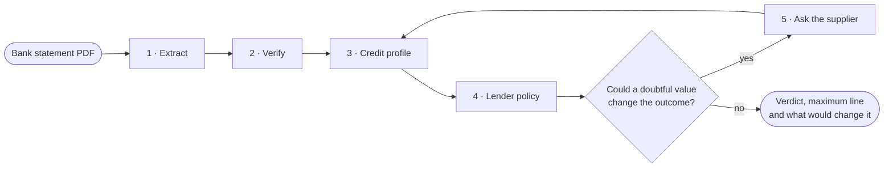
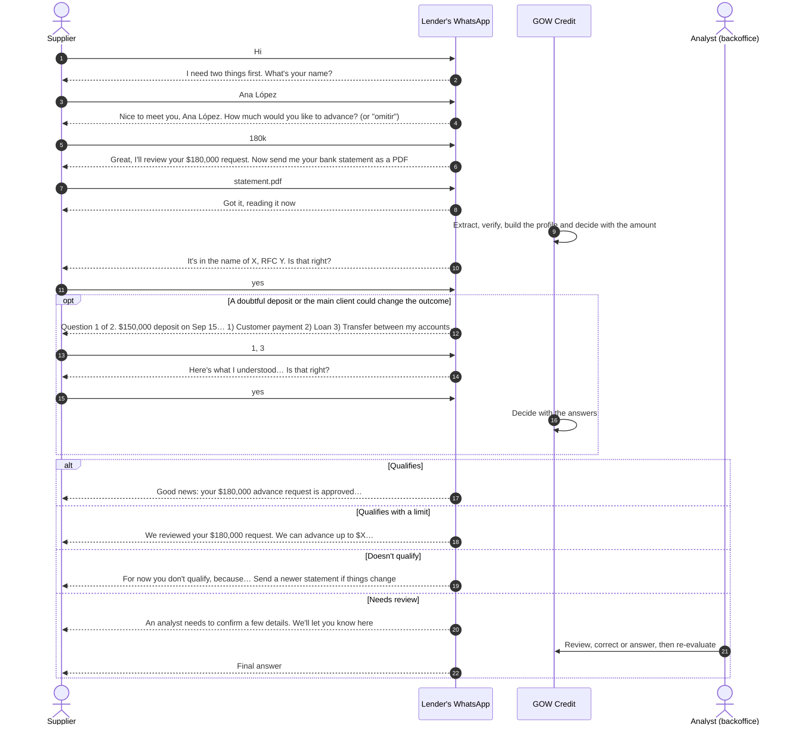
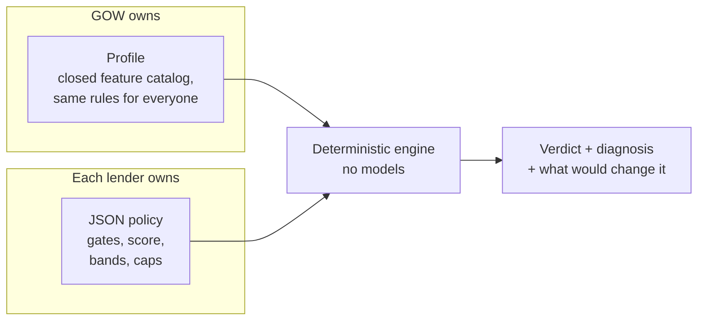
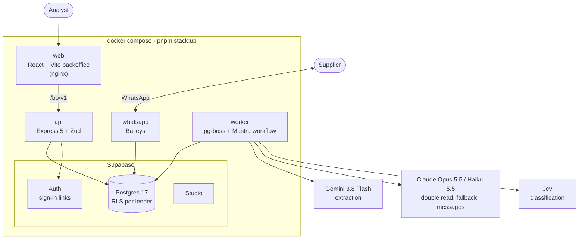
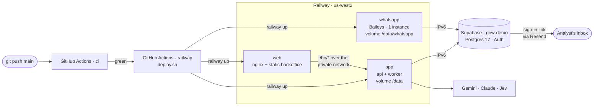
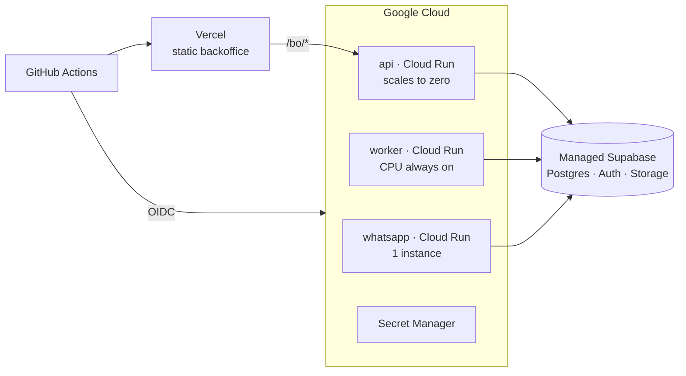

<div align="center">

# GOW Credit

### Early payment decisions from a bank statement, over WhatsApp.

A supplier sends their bank statement as a PDF. A few minutes later they know how much of their
invoices they can get paid early, and why. If something in the statement is unclear and could
change the answer, the system asks them first.

[](https://github.com/moydany/gow-credit/actions/workflows/ci.yml)
[](https://github.com/moydany/gow-credit/actions/workflows/railway.yml)

**English** · [Español](README.es.md)

<br/>

| **1,513 / 1,513** | **0** | **9 / 9** | **USD 0.20** |
|:---:|:---:|:---:|:---:|
| transactions extracted | invented or missed | statements that reconcile | per document |

<sub>On the 9 development statements, with Gemini 3.8 Flash.</sub>

</div>

---

## Contents

1. [For reviewers](#for-reviewers)
2. [Try the live demo](#try-the-live-demo)
3. [The problem in one minute](#the-problem-in-one-minute)
4. [What it does](#what-it-does)
5. [Run it on your machine](#run-it-on-your-machine)
6. [How the demo works](#how-the-demo-works)
7. [How credit is decided](#how-credit-is-decided)
8. [What you can configure](#what-you-can-configure)
9. [Architecture](#architecture)
10. [The demo on Railway](#the-demo-on-railway)
11. [Accuracy and keeping the model honest](#accuracy-and-keeping-the-model-honest)
12. [CI/CD and the road to production](#cicd-and-the-road-to-production)
13. [Known limits](#known-limits)
14. [Repository map](#repository-map)

## For reviewers

Everything the worksample asks for, and where to find it.

| Deliverable | Where |
|---|---|
| A running system | [Try the live demo](#try-the-live-demo), or [run it locally](#run-it-on-your-machine) in one command |
| What we understood, assumptions and scope | [`docs/00-spec.md`](docs/00-spec.md) |
| Design decisions and why | [Architecture](#architecture), [How credit is decided](#how-credit-is-decided), and the full design in `docs/01` to `docs/09` |
| Prompts | [`prompts/`](prompts/), versioned, with a [changelog](prompts/CHANGELOG.md) |
| Data contracts | [`docs/schema/`](docs/schema/), JSON Schema generated from the Zod contracts |
| CI/CD | [`.github/workflows/`](.github/workflows/) and [CI/CD and the road to production](#cicd-and-the-road-to-production) |
| Deployment | [The demo on Railway](#the-demo-on-railway) today; the production plan in [`docs/deploy.md`](docs/deploy.md) |

> [!NOTE]
> The design documents under `docs/` are written in Spanish, like the messages the system sends to
> suppliers. Code, identifiers and comments are in English.

## Try the live demo

The demo runs on Railway and Supabase, and every push to `main` that passes CI updates it.

| | URL |
|---|---|
| **Backoffice** | https://web-production-d5e9bd.up.railway.app |
| API | https://app-production-aa52.up.railway.app (health at [`/healthz`](https://app-production-aa52.up.railway.app/healthz)) |

Sign-ups are closed: you get in with a sign-in link sent to an invited email. Ask for an
invitation, then open the backoffice, go to `/entrar`, type your email and open the link you
receive. The bot speaks Spanish, and so does the backoffice.

> [!TIP]
> Want to poke at the internals instead? Any request shows the PDF next to what was read from it,
> and the **Recorrido** tab replays every message, model call and decision step by step.

## The problem in one minute

Suppliers in a distribution chain wait weeks to get paid. A lender can pay their invoices early,
but deciding who qualifies is done by hand: someone opens the bank statement, reads it line by line
and guesses which deposits are real sales. That takes days.

GOW Credit turns that into minutes, without asking anyone to trust a black box:

- **Every number is traceable.** Each value carries the page and the snippet it came from.
- **The bank's own math is the referee.** If the extraction doesn't add up, the system notices.
- **No model makes the decision.** Models read and write text. A deterministic engine applies the
  lender's own policy.
- **A "no" comes with a way forward.** The answer says what would change it.
- **When in doubt, it asks.** A short WhatsApp question beats a wrong rejection.

## What it does



1. **Extract** the header, summary, every transaction and the CFDI the bank stamps on the statement,
   each with its page and snippet.
2. **Verify** against the bank's arithmetic: opening balance plus credits minus debits equals the
   closing balance, printed totals and counts, the running balance, CLABE, RFC and dates. Anything
   that doesn't add up is re-read page by page.
3. **Build a profile**: operating income, payment capacity, debt service, recurring income, payments
   from the buyer, red flags.
4. **Apply the lender's policy** (each lender is a tenant) with a pure engine.
5. **Ask the supplier** over WhatsApp when an ambiguous deposit could change the result, then decide.

Every request ends in one of six states:

| State | Meaning |
|---|---|
| `qualified` | Qualifies for the full line of its score band |
| `qualified_with_limit` | Qualifies with a smaller or capped line |
| `not_qualified` | Doesn't qualify; the diagnosis says what would change that |
| `needs_clarification` | Waiting for an answer from the supplier |
| `human_review` | An analyst confirms before anyone gets an answer |
| `failed` | The document couldn't be read; the reason is recorded |

## Run it on your machine

The whole system, including a local Supabase, comes up with one command. You need Docker and two
API keys.

### What you need

| You need | Why |
|---|---|
| **Docker** with **Compose v2** (Docker Desktop on macOS or Windows) | Everything runs in containers. Compose must support `--wait` |
| **Node 24+** and **pnpm** (`corepack enable`) | Only to launch `pnpm stack:up` and generate local secrets the first time. No `pnpm install` needed |
| About **8 GB of free disk** | Supabase images (about 6.5 GB) plus the app image |
| Free ports on `127.0.0.1` | `5173` (backoffice), `3000` (API), `54340`–`54343` (Postgres, gateway, Studio, mail) |
| **`ANTHROPIC_API_KEY`** (required) | Double read, fallback extraction, fallback classification and supplier messages |
| **`GEMINI_API_KEY`** (recommended) | Extraction with Gemini 3.8 Flash. Without it Claude Opus 5.5 extracts, about 5× the cost |
| `TYPESAFE_API_KEY` (optional) | Classification with Jev. Without it Claude Haiku 5.5 classifies |
| `RESEND_API_KEY` and `RESEND_FROM` (optional) | Backoffice sign-in emails through Resend. Without them they land in the local inbox |
| A **phone with WhatsApp** | To link the lender's number by scanning a QR. A test number is best |

### Start it

```bash
git clone https://github.com/moydany/gow-credit.git
```

```bash
cd gow-credit
```

```bash
cp .env.example .env
```

Open `.env` and fill in at least `ANTHROPIC_API_KEY` and `GEMINI_API_KEY`. Then:

```bash
pnpm stack:up
```

The first run generates development secrets, pulls Supabase and builds the app image, so give it a
few minutes. It returns once every service is healthy and prints where everything lives:

| Address | What it is |
|---|---|
| http://127.0.0.1:5173 | **Backoffice.** Opens the setup wizard the first time |
| http://127.0.0.1:3000 | API |
| http://127.0.0.1:54342 | Supabase Studio, to look at the database |
| http://127.0.0.1:54343 | Local inbox with the sign-in emails |

| Command | What it does |
|---|---|
| `pnpm stack:up` | Generates missing secrets, builds and starts everything |
| `pnpm stack:ps` | Status of each service |
| `pnpm stack:logs` | Follows the API, worker and WhatsApp logs |
| `pnpm stack:down` | Stops everything and keeps the data |
| `pnpm stack:reset` | Stops and wipes the database, the WhatsApp session and the documents |

> [!TIP]
> Ports 5173 or 3000 taken? `GOW_WEB_PORT=8080 GOW_API_PORT=3100 pnpm stack:up`.

> [!NOTE]
> Everything listens on `127.0.0.1` only. The secrets `pnpm stack:up` generates are for development
> and live in `infra/supabase/.env`, outside git.

### First-run setup

On an empty system the backoffice opens a two-step wizard. No terminal needed.

1. **Account.** Enter the lender's name and the admin's email. This creates the lender, its active
   base policy and the admin, and signs you in for 8 hours.
2. **WhatsApp.** A QR appears. On the phone: *WhatsApp → Linked devices → Link a device*, then scan
   it. The backoffice shows the linked number a few seconds later. You can pick *Omitir por ahora*
   (skip for now) and link it later under **Configuración → General → Canales**; until then,
   clarifications are answered by hand in the backoffice.

From then on, under **Configuración**:

- **Users**: invite people. They get a sign-in link by email (in the local inbox at `:54343` if
  Resend isn't set up).
- **Signing back in**: go to `/entrar`, type your email and open the link you receive.

## How the demo works

The lender links a number, and suppliers message it. Any unknown number can register: the bot asks for their name and how much they want to advance,
then for their statement (turn that off with `WHATSAPP_SELF_REGISTRATION=false`).



<sub>The bot speaks Spanish; the messages above are translated.</sub>

**What the bot does at each step**

- **Greeting.** It asks for the name of the person writing and the amount to advance ("180000",
  "180 mil", "1.2 millones" or "omitir"), then for the statement. A PDF that arrives early is kept
  and read once it has both.
- **Registration.** It reads the holder and RFC from the statement and asks the supplier to
  confirm. If they're wrong, it asks for name and RFC; for a company RFC it also asks for the legal
  representative. A typed RFC must start like the one printed on the statement.
- **Documents that won't work.** A password-protected PDF, an unreadable scan, something that isn't
  a bank statement, or several statements in one PDF each get a specific reply, and the bot waits
  for a new PDF.
- **Questions.** One at a time, with numbered options. It accepts several answers in one message
  (`1, 3`), free corrections ("my bad, number 2 was a loan") and "I don't know". Before evaluating it
  shows a summary to confirm. What rules can't parse, Claude Haiku reads, but only by picking one of
  the offered options; it never makes up an answer.
- **Amount.** With the amount from the greeting it decides once, with that amount. If they skipped
  it, it decides with the maximum line and, if they qualify, asks how much to advance (anything above
  the line gets asked again). With an amount and no buyer, if knowing their main client could improve
  the result, it asks before deciding.
- **Never in the chat:** balances, CLABE, or the engine's internal reasons.

**In the backoffice**

| Screen | What it's for |
|---|---|
| Solicitudes | Every request with its state, line and flags |
| Detalle | The PDF next to the extraction: click a value to jump to its page and snippet. Profile, verdict with the full diagnosis and counterfactuals |
| Recorrido | The request step by step in 3D: messages, reads, model calls and decisions |
| Aclaraciones | Pending questions, answered by hand when the supplier has no WhatsApp |
| Revisión | Analyst corrections to the extraction, stored as immutable pairs and re-evaluated |
| Proveedores | Add, search and remove suppliers with everything that belongs to them. On a supplier's page you can upload a statement with the amount to request and watch the evaluation run to its result |
| Outcomes | Whether each credit was repaid or defaulted, to measure the policy |
| Bitácora | Who did what, and every model call with its cost |
| Configuración | General (statement age, WhatsApp, users), policies and prompts |

## How credit is decided

GOW Credit doesn't lend. It gives each lender the infrastructure to apply **their own** policy, so
the decision lives in three separate layers.



**Why this shape.** A bare "no" helps neither the supplier nor the lender. The engine returns the
result, every reason behind it and **counterfactuals**: the smallest change that would move the state
or the line ("two more payments from the buyer would get you to `qualified`"). A rejection becomes a
path. And because the engine is pure, the same extraction, policy and date always give the same
verdict.

### 1. Gates: what stops a request before scoring

| Gate | Passes when | Otherwise | Why |
|---|---|---|---|
| Recent statement | The statement closed 90 days ago or less | Asks for a newer one | An old statement doesn't describe today's cash flow. The backoffice can turn this into a warning instead |
| Complete pages | It has every page its own pagination prints | Asks for the missing pages | A missing page can hide debits |
| Integrity | It reconciles against the bank's balances and totals | `human_review` | If it doesn't add up, either the extraction or the document has a problem |
| No red flags | No overdraft, bounced check, garnishment, court order or tax demand | `human_review` | Risk signals a person should see |
| No tampering | No text aimed at the system, a consistent tax stamp, no repeated pages | `human_review` | Guards against altered documents and hidden instructions |
| No arrears | No days past due on current credits with this lender | `not_qualified` | Being late today outweighs any score |

### 2. Score: five dimensions, 0 to 100

| Dimension | Weight | What it measures | 0 points at | Full points at |
|---|---:|---|---|---|
| Capacity | 35 | Monthly operating income against the requested amount | 0.5× the amount | 3× the amount |
| Buyer | 25 | Identified payments from the buyer (the chain) | 0 payments | 2 payments |
| Stability | 15 | Payment capacity: free cash flow / income | 10 % | 50 % |
| Debt | 15 | Debt service / income (lower is better) | 40 % | 10 % |
| Recurrence | 10 | Share of income that repeats | 20 % | 60 % |

**Why these weights.** Early payment is repaid from the supplier's own cash flow and, above all,
from the invoice the chain owes them. That's why capacity and buyer add up to 60. "Operating income"
leaves out transfers between the supplier's own accounts, loans received and doubtful deposits:
padding income with your own money is the most common trick in a bank statement. A value with
confidence below 0.7 doesn't count toward the score.

### 3. Bands, caps and the line

| Score | State | Band line |
|---|---|---|
| 70 or more | `qualified` | 50 % of monthly operating income |
| 50 to 69 | `qualified_with_limit` | 25 % of monthly operating income |
| Below 50 | `not_qualified` | — |

- **Caps.** With under 3 months of history, or no payment at all from the buyer, the best possible
  state is `qualified_with_limit`. A short history isn't enough for the full line.
- **Final line** = the smallest of the band line, the debt capacity minus what the supplier already
  owes this lender, and what's left in the buyer's program.
- **Clarifications.** Up to 2 rounds. The system only asks about doubtful deposits larger than 30 %
  of the period's income that could change the state or the line.

## What you can configure

| Where | What | Values |
|---|---|---|
| Backoffice → Configuración → General | Maximum statement age | 1, 2, 3 (default), 6 or 12 months, or no limit. Past the limit the request gets a warning, not a block |
| Backoffice → Configuración → General | WhatsApp number | Link, unlink or switch by scanning a QR |
| Backoffice → Configuración → General | Users | Invite or remove people; everyone sees and works the lender's requests |
| Backoffice → Configuración → Políticas | **The whole policy** | A JSON draft validated with the engine's own schema. Before activating it, you **simulate** it against real requests: how many improve, get worse or change line, and the observed default rate. Every version is kept |
| Backoffice → Configuración → Prompts | The model prompts | Editing creates a new version and activating it is a separate step; versions can be compared. They're shared by all lenders |
| `.env` | Model and email keys | See [What you need](#what-you-need) |
| `.env` | `LLM_CACHE_MODE` | `readwrite` (default) or `read`: with `read` no model is ever called and a rerun costs nothing |
| `.env` | `WORKER_MODEL_CONCURRENCY` | Model calls in flight at once (default 3) |
| `.env` | `WHATSAPP_SELF_REGISTRATION` | `true` (default) or `false` |
| `.env` | `GOW_TIME_ZONE` | Business calendar time zone (default `America/Mexico_City`) |
| At startup | `GOW_WEB_PORT`, `GOW_API_PORT` | Backoffice and API ports |

<details>
<summary><b>What a policy contains</b></summary>

<br/>

The base template is [`policies/gow-base.v1.json`](policies/gow-base.v1.json) and its schema is
[`docs/schema/policy.schema.json`](docs/schema/policy.schema.json).

| Field | Defines |
|---|---|
| `gates[]` | Gates: `feature`, operator, value, what happens on failure (`onFail`) and when the value is missing (`onUnknown`) |
| `score.dimensions[]` | Dimensions with `weight`, `zeroAt`, `fullAt`, `relativeTo` and `inverse` |
| `score.minConfidence` | Minimum confidence for a value to count |
| `decision.bands[]` | Minimum score, state and line (`pctOf` a feature) |
| `decision.caps[]` | Conditions that cap the best possible state |
| `decision.limitFormula` | How the final line is combined |
| `clarification` | Maximum rounds and from what size a deposit gets asked about |

A policy can only use features from the closed catalog; one that names an unknown feature doesn't
validate.

</details>

## Architecture

Four processes, one database, and no process ever calls another one directly.



One image runs the API, the worker and WhatsApp; the `APP` variable picks which. The processes
coordinate only through the database (queue, outbox and states), so any of them can restart without
losing work. Each one connects with its own Postgres role, and row-level security is forced on every
business table, so a bug in one process can't read another lender's data.

**A PDF's journey.** WhatsApp stores it and opens a request → the queue hands the job to the worker →
the workflow extracts, verifies, builds the profile and decides → if there are questions, the
workflow **suspends** and the question leaves through the outbox → the supplier's answer **resumes**
the workflow, which decides → the verdict goes out over WhatsApp.

### Why each piece

| Piece | Used for | Why this one |
|---|---|---|
| **Gemini 3.8 Flash** | Reading the statement | On the 9 development statements it matched Claude Opus (1,513 of 1,513 transactions, 9 of 9 reconcile) at a fifth of the cost: USD 1.80 against 9.16. It takes the whole PDF and the output schema, with implicit caching |
| **Claude Opus 5.5** | Fallback and re-reads | If Google is down, Opus redoes the document. If a block doesn't reconcile, Opus re-reads it. The header double read uses the other model family, so two identical mistakes are unlikely |
| **Claude Haiku 5.5** | Supplier messages and replies | Writes questions in plain language and reads the replies rules can't, always choosing among closed options. Fast and cheap for short text |
| **Jev** (TypeSafe AI) | Classifying documents and ambiguous transactions | Returns calibrated probabilities per question, not just a label, which is what deciding *when to ask* needs. 32 of 33 on the classifier eval, about USD 0.015 per 1,000 transactions. Rules go first and Jev only sees what they can't settle; without a key, Haiku takes over |
| **Mastra** | Orchestrating the workflow | The problem is a pipeline with a pause that can last days: waiting for the supplier. Mastra gives persisted `suspend()` and `resume()` in Postgres, structured output and traces. The alternative was hand-writing a state machine. Where Mastra hides something that needs measuring, the code drops to the SDK |
| **Supabase** | Database, sign-in and files | Postgres with **forced RLS** per lender (leaking data between lenders is the worst possible incident), Auth for sign-in links, and Storage, in one service. Locally it runs self-hosted with the same roles as production |
| **pg-boss** | Job queue | Reading a long PDF takes minutes. pg-boss lives in the same Postgres (no extra broker), with retries, a dead-letter queue and an idempotency key on the document hash, so a repeated PDF is never paid for twice |
| **Baileys** | WhatsApp | Links a regular number with a QR, no Meta template approval. Right for a demo; production would use the official API behind the same interface |
| **Zod** | Contracts | One source of truth: types, API validation and the JSON Schema in `docs/schema/` all come from the same schema |
| **Drizzle** | Data access | SQL first, with RLS policies in the schema and versioned migrations |
| **React + Vite** | Backoffice | A static app that only talks to `/bo/v1`; in production it sits on a CDN |

## The demo on Railway

The demo exists so that a non-technical person can log in with their email and work a request. It
runs the same image and the same code as the local stack, laid out a little differently to fit
Railway's model: a hosted Supabase project for Postgres and Auth, and three Railway services.



| Service | What runs | Why it's shaped this way |
|---|---|---|
| `app` | The API and the worker in one container, started by `app-start.sh`. Public domain | A Railway volume mounts on exactly one service, and the API and the worker both need the document disk (`/data`). If either process dies, the container exits and Railway restarts it |
| `web` | The static backoffice behind nginx, built from `web.Dockerfile`. Public domain: the one people open | nginx forwards `/bo/*` to `app` over Railway's private network, so the session cookie stays same-origin. It resolves `app.railway.internal` on every request and starts even if `app` isn't up yet |
| `whatsapp` | `APP=whatsapp`, exactly one instance. No public domain | Two Baileys sessions on the same number kick each other out. Its session lives on a volume, so a restart doesn't ask for the QR again |
| Supabase `gow-demo` | Postgres 17 with the same roles and RLS as local, and Auth sending sign-in links through Resend | Only Supabase Auth sends the email links the backoffice uses, and a hosted project is the only place the Railway services can reach it from |

**How a push becomes the running demo**

1. You push to `main`. The `ci` workflow runs: typecheck, lint, tests, scenarios, evals, builds.
2. If CI is green, the [`railway`](.github/workflows/railway.yml) workflow checks out **that same
   commit** and runs `infra/railway/deploy.sh`. A red CI deploys nothing.
3. `deploy.sh` ships the commit with `git archive`, never the working folder, so `data/`, `.env` and
   anything uncommitted stay out. It calls `railway up` once per service, `app` first.
4. Railway builds each image from the repository's `Dockerfile` (`web` from
   `infra/railway/web.Dockerfile`). Before the new `app` container takes traffic, its **pre-deploy**
   gives the database roles their passwords and runs the migrations; the container goes live only
   once `/healthz` answers, and then the old one is retired. `web` and `whatsapp` simply restart on
   their new image.
5. A job that was mid-flight when the worker restarted is retried by the queue, and the WhatsApp
   session survives on its volume.

The same deploy runs from a laptop with `sh infra/railway/deploy.sh [ref] [services]`, after
`railway link`. The workflow only needs one GitHub secret, `RAILWAY_TOKEN`, a project token of the
`production` environment. Model keys, database passwords and Supabase keys never pass through
GitHub: they live in the Railway variables of each service, and `set-db-passwords.sh` generates one
password per database role without ever printing it.

**What's different from the production plan, on purpose**

| | Railway demo | Cloud Run plan |
|---|---|---|
| API and worker | One container, one volume | Two services that scale apart |
| Backoffice | nginx on Railway, proxy to `app` | Vercel CDN with a `/bo/*` rewrite |
| WhatsApp session | Kept on a volume | Lost on restart (open gap) |
| Secrets | Railway variables | Secret Manager, one set per service |
| Migrations | Pre-deploy of `app` | A `migrate` job before any service |
| Trigger | Push to `main` with CI green | By hand, with approval in `production` |
| TLS to Postgres | Certificate not verified | Verified |

Step by step setup, variables and the Supabase Auth configuration are in
[`docs/deploy.md`](docs/deploy.md), under "Demo en Railway".

## Accuracy and keeping the model honest

Extraction is the metric that matters most, and a model can make things up. So the system doesn't
trust the model: it **checks** it.

| On the 9 development statements | Gemini 3.8 Flash | Claude Opus 5.5 |
|---|---|---|
| Transactions extracted | 1,513 / 1,513 | 1,513 / 1,513 |
| Invented / missed | 0 / 0 | 0 / 0 |
| Header and summary | 120 / 120 fields | 120 / 120 fields |
| CFDI | 104 / 107 fields | 106 / 107 fields |
| Statements that reconcile | 9 / 9 | 9 / 9 |
| Cost for all 9 | USD 1.80 | USD 9.16 |

The ground truth comes from a deterministic per-bank parser over the PDF's text layer, refereed by
the bank's arithmetic, and never from the model being measured.

**What protects documents the system has never seen**

- **Citations.** Every value carries its page and snippet. A value without one is marked unverified.
- **The bank's math as the anchor.** Opening + credits − debits = closing, printed totals and
  counts, and the running balance row by row. A model mistake almost always breaks one of these sums.
- **Targeted re-reads.** What doesn't reconcile is re-read on its own page; if it still doesn't, it's
  flagged and the engine sees it.
- **Double read** of the header with the other model family. If they disagree, the system asks.
- **Validators**: CLABE check digit, RFC structure, dates inside the period, cross-checks with the
  CFDI.
- **Prompt injection.** Text in the PDF is data, never an instruction. An eval with adversarial PDFs
  runs in CI and must pass at 100 %.
- **What can't be verified is marked**, and if it could change the result, the supplier is asked.

**Reproducibility.** Every model response is cached under a key that includes the model, the prompt,
the schema and the document hash, so rerunning with `LLM_CACHE_MODE=read` gives exactly the same
output for free. Models, prompts and dependencies are pinned. A fresh model call isn't deterministic,
but every extraction goes through the same contract, validators and reconciliation; a difference
between two reads shows up as a flag or a question, never silently.

## CI/CD and the road to production

| Workflow | Runs on | What it does |
|---|---|---|
| [`ci.yml`](.github/workflows/ci.yml) | Every push to `main` and every PR | Strict typecheck, lint (including size, complexity and duplication), unit tests, end-to-end scenarios against Postgres 17, injection and classifier evals without keys, backoffice build, API and worker images, gitleaks and osv-scanner |
| [`eval-extraction.yml`](.github/workflows/eval-extraction.yml) | PRs that touch prompts, extraction, models or contracts | Extraction against the ground truth with a per-bank threshold. Restores the private data from an encrypted bundle and fails if any metric drops below the threshold |
| [`railway.yml`](.github/workflows/railway.yml) | After a green `ci` on `main` | Ships that commit to the three Railway services with `deploy.sh`. See [The demo on Railway](#the-demo-on-railway) |
| [`deploy.yml`](.github/workflows/deploy.yml) | By hand only, per environment (`staging` or `production`) | Images → migration → Cloud Run services, plus the backoffice on Vercel. No JSON keys: GitHub-to-Google federated identity, and `production` requires approval |

Production on Google Cloud is designed and the pipeline is written, but it has never run: the
worksample didn't create cloud accounts. The shape is the one the demo approximates, with each
process scaled on its own.



Regions, parameters, secrets, operating costs and what's still missing are in
[`docs/deploy.md`](docs/deploy.md).

## Known limits

- **Production isn't deployed.** The Railway demo runs; the Cloud Run pipeline is ready but has never
  run.
- **The demo cuts corners.** TLS to Supabase doesn't verify the certificate, the API and the worker
  scale together, and self-registration over WhatsApp is on.
- **WhatsApp through Baileys**, not Meta's official API: fine for a demo, not for production.
- **No SAT or credit bureau yet.** The profile is designed to take them as new signals without
  changing the engine, but they aren't connected.
- **Documents on disk.** Supabase Storage runs, but its adapter isn't wired in; PDFs live on a
  volume.
- **Development data stays out of the repository.** Statements, ground truth and cache are never
  committed.

## Repository map

| Folder | What's inside |
|---|---|
| `apps/api` | HTTP API: backoffice, requests, clarifications, policies, first-run wizard |
| `apps/worker` | Queue and workflow: extraction, decision, outgoing messages |
| `apps/whatsapp` | WhatsApp channel (Baileys) |
| `apps/web` | Backoffice (React 19 + Vite) |
| `packages/contracts` | Zod contracts: extraction, profile, policy, verdict, request |
| `packages/extraction` | Model routing, passes, validators, reconciliation, tax block |
| `packages/llm` | Models and prices, structured client, response cache, classifiers |
| `packages/decision` | Profile, policy engine, counterfactuals and simulation |
| `packages/mastra` | The `processApplication` workflow |
| `packages/db`, `packages/platform`, `packages/channels` | Database with RLS, queue and storage, WhatsApp conversation |
| `policies/` | Base policy template |
| `prompts/` | Versioned prompts and their changelog |
| `evals/`, `scenarios/` | Extraction and injection evals; end-to-end scenarios |
| `infra/railway/` | The demo: service configuration, deploy, nginx, pre-deploy, Supabase Auth |
| `infra/`, `scripts/` | Local Supabase, backoffice nginx, `stack.sh` |
| `docs/` | Design (`00` to `09`), schemas, deployment |
