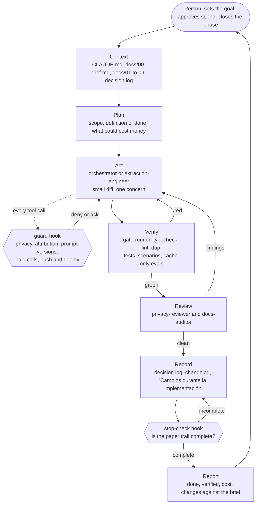

# The development harness

This repository was built by one person directing a coding agent (Claude Code, in the desktop
app). This is a technical evaluation, so I ran the build to the highest standard I know how to
hold: the same one I would defend in a production review. The design was written before the code,
every paid model call was approved with a number in front of me, nothing was called done until it
had been run, and every change of mind left a record.

This document describes the harness: the control loop the agent works inside, the configuration
that enforces it, and what it cost. Everything it links to is in the repository and can be opened.
The design documents, the agent configuration and this file were kept local during the build and
committed together at delivery, so their commit dates are later than the work they describe.

- [The loop](#the-loop)
- [What the agent reads](#what-the-agent-reads)
- [Agents](#agents)
- [Skills](#skills)
- [Hooks: rules the agent cannot skip](#hooks-rules-the-agent-cannot-skip)
- [Gates](#gates)
- [Model spend](#model-spend)
- [How the build went](#how-the-build-went)
- [What I would do differently](#what-i-would-do-differently)

## The loop

An agent that writes code and then judges its own code will pass itself. The harness is built
around that one failure mode: the agent that makes a change is never the one that verifies it,
and the person, not the agent, decides when a unit of work is closed.

Each stage exists for a reason:

| Stage | What happens | Why it is there |
|---|---|---|
| Context | The agent reads the brief and the documents for the area before touching code | The decisions were made before the code; the agent implements them, it does not rediscover them |
| Plan | Scope and definition of done are stated up front, including any step that costs money | A unit with no stated end cannot be verified |
| Act | One concern per change, small commits | The history is part of the deliverable and has to be readable |
| Guard | A hook inspects every tool call | The rules that must never break are enforced by code, not by the agent remembering them |
| Verify | A separate agent with no write access runs the gates and reports | The author does not grade its own work, and "should pass" is not a result |
| Review | Two read-only agents check what a test suite cannot: leaked personal data, and drift from the design | Passing tests say nothing about a name in a log line or a decision that changed silently |
| Record | A decision becomes an entry in the decision log; a prompt change becomes a changelog entry | Evaluators judge the reasoning as much as the result |
| Stop check | A hook refuses to end the turn while the record is incomplete | The paper trail is the step most easily skipped |
| Report | Four sections: done, verified, cost, changes against the brief | The person decides whether to continue on evidence |

The loop stops in three places for a human: before model spend, before anything leaves the
machine (push, merge, deploy), and at the end of every unit.

## What the agent reads

| File | Role |
|---|---|
| [`CLAUDE.md`](../CLAUDE.md) | Entry point: what to read first, the rules that are not negotiable, the pinned model versions, the commands |
| [`docs/00-brief.md`](00-brief.md) | The implementation brief: the table of final decisions (not reopened without recording why), the phases with their definition of done, the cut lines |
| [`docs/01` to `09`](README.md) | The design, written before the first line of code. Never rewritten: what changed while building is appended as "Cambios durante la implementación", so planned and built stay distinguishable |
| [`docs/decisions.md`](decisions.md) | The decision log: each decision that shaped the system, what it was chosen over and why, including the ones that were later reversed |
| [`prompts/`](../prompts/CHANGELOG.md) | Every product prompt as a versioned file with a changelog from the first draft. A version is immutable once evaluated; the version is part of the cache key and of the queue's idempotency key |
| [`docs/spikes/`](spikes/README.md), [`docs/experiments/`](experiments/) | Measurements taken before building on an assumption |

When the agent believed a decision in the brief was wrong, the rule was to write the objection
down and proceed with what was decided. The switch to Gemini as the extraction model is the
example: objection recorded, small experiment run, decision confirmed by the phase 3 evals.

## Agents

Defined in [`.claude/agents/`](../.claude/agents/). The main session is the orchestrator; it
delegates to these and never substitutes its own judgment for their output.

| Agent | Access | Job |
|---|---|---|
| [`gate-runner`](../.claude/agents/gate-runner.md) | Read and shell, no edits | Runs every gate, including cache-only evals when extraction code changed. Reports a table plus the failing output. Offers no fixes, so it has no stake in the result |
| [`extraction-engineer`](../.claude/agents/extraction-engineer.md) | Full | Owns changes to prompts, the extraction contract, the model router and the verification passes. Works hypothesis first: baseline, change, measured result. May not weaken a verification pass to move a metric |
| [`docs-auditor`](../.claude/agents/docs-auditor.md) | Read-only | Reads the documents as the contract and the code as the claim. Lists gaps with file and line, ordered by how much an evaluator would care |
| [`privacy-reviewer`](../.claude/agents/privacy-reviewer.md) | Read-only | Reviews a diff for personal data in logs, traces, fixtures, snapshots, docs and screenshots, and for secrets in code |

The reviewers start with a clean context on purpose. An auditor that watched the code being
written inherits the author's assumptions about it.

## Skills

Defined in [`.claude/skills/`](../.claude/skills/). They are procedures the agent loads when the
situation calls for them.

| Skill | When | What it fixes in place |
|---|---|---|
| [`phase-gate`](../.claude/skills/phase-gate/SKILL.md) | Closing a phase, a feature or a refactor | The order: freeze scope, independent verification, at most three fix rounds per failure, reviews, paper trail, four-part report, stop |
| [`paid-run`](../.claude/skills/paid-run/SKILL.md) | Before any command that can call a paid model | Cache first, one or two documents before a full run, an estimate from measured per-document cost, explicit approval, actual cost recorded next to the estimate |
| `claude-api` (built into Claude Code) | Before writing any Anthropic SDK call | Current API shape. It kept `budget_tokens`, `temperature` and older output formats out of the code |

## Hooks: rules the agent cannot skip

Instructions can be forgotten in a long session; a hook cannot. Two scripts, wired in
[`.claude/settings.json`](../.claude/settings.json), both plain Node with no dependencies.

[`guard.mjs`](../.claude/hooks/guard.mjs) runs before every shell command, file read and file
write:

| Rule | Action |
|---|---|
| A commit message with `Co-Authored-By` or "Generated with Claude" | Denied |
| `git add` of `data/`, a PDF, the data bundle or `.env` | Denied |
| Printing a statement or ground-truth file (`cat`, `head`, `pdftotext` and similar on `data/dev`, `data/ground-truth`) | Denied |
| Reading or writing `.env`, the data bundle or the private folders of `data/` through the file tools | Denied |
| `pnpm run evaluate`, `pnpm extract` or `pnpm eval` without the read-only cache | Stops and asks the person, with the reason |
| Editing a prompt version that is already tracked | Stops and asks: a change is a new version plus changelog plus eval |
| `git push`, `gh pr merge`, a Railway deploy | Stops and asks |

[`stop-check.mjs`](../.claude/hooks/stop-check.mjs) runs when the agent tries to end a turn. It
blocks once, with the reason, if a prompt file changed without an entry in
`prompts/CHANGELOG.md`.

The same file turns off agent attribution on commits and pull requests. The history has one
author because one person is accountable for it.

## Gates

A change is not done until these are green. The same commands run locally, through
`gate-runner`, and in CI ([`.github/workflows/`](../.github/workflows/)).

| Gate | Command | What it holds |
|---|---|---|
| Types | `pnpm typecheck` | Strict TypeScript across the monorepo; Zod is the only source of truth for contracts |
| Lint | `pnpm lint` | Type-aware ESLint with zero warnings allowed, including file size, function size, cyclomatic and cognitive complexity |
| Duplication | `pnpm dup` | Cross-file clones (jscpd) |
| Tests | `pnpm test` | Vitest; with Postgres up, also row-level security and tenant isolation |
| Scenarios | `pnpm scenario run --all` | The end-to-end catalogue with simulated adapters, in unit and full mode |
| Injection and classifier evals | Evalite, no keys | Synthetic adversarial PDFs against recorded responses; the injection eval must score 100 % |
| Extraction eval | `pnpm eval` | Extraction against ground truth with a threshold per bank. In CI it runs cache-only from an encrypted bundle and never calls a model |
| Supply chain | gitleaks, osv-scanner | No secrets in the history, no known-vulnerable dependencies; actions pinned by SHA |

Two properties make the extraction gate trustworthy rather than decorative:

- **The ground truth does not come from the model being measured.** It is produced by a parser
  per bank over the PDF text layer and arbitrated by the bank's own arithmetic.
- **No prompt or model change in the repository merges if it drops a bank below its threshold.**
  That is how the switch to Gemini was confirmed instead of assumed.

The response cache (`data/llm-cache/`) is what makes the loop affordable. Its key combines model,
prompt version, output schema and document hash, so during development every repeated run, eval
and scenario replays at zero cost. It lives under `data/` and is not part of the repository.

## Model spend

Building the system cost about USD 20 in model calls.

| Stage | Spend |
|---|---|
| Spikes | USD 0.28 |
| Phases 1 and 2: extraction with Opus, two full runs plus re-reads | about USD 17 (Anthropic) |
| Haiku, Sonnet and Gemini experiments | about USD 1.9 (Anthropic) and USD 0.51 (Google) |
| Phase 3: ground truth and evals | USD 0.34 |
| Phase 4 | USD 0 |
| Phase 5 | USD 0.017 |
| Phases 6 to 8 | no paid calls reported; scenarios, demo and `evaluate` ran from cache |

Almost all of it was spent before the cache and the ground truth existed. After that, spend per
phase rounds to zero.

The question "is a cheaper model enough?" was always answered on one or two documents first
([`docs/experiments/`](experiments/)):

| Model | Document | Cost | Result |
|---|---|---|---|
| Haiku | BBVA | USD 0.05 | Same rows, but after 4 re-reads |
| Sonnet | BBVA | USD 0.50 | Equal to Opus, at the same price |
| Sonnet | Nu | USD 0.84 | Invented a duplicated charge; the arithmetic reconciliation caught it |
| Gemini 3.8 Flash | BBVA and Nu | USD 0.19 and USD 0.32 | Equal to Opus |

Only then was Gemini measured on all 9 documents against the ground truth.

## How the build went

- **Phases with a hard stop.** At the end of each phase the agent stopped and reported what it
  did, what it verified by running it, what it cost and what changed against the brief. I decided
  whether to continue.
- **Spikes before commitments** ([`docs/spikes/`](spikes/README.md)). Four assumptions were
  measured before anything was built on them: Mastra with PDF input, caching and structured
  output (which showed the schema is part of the cached prefix and led to the single-schema decision), version
  compatibility, Jev against Haiku, and suspend and resume across processes.
- **One session per phase from phase 3**, plus a separate documentation-analysis session with a
  clean context that audited the repository against the documents at each phase close and sent
  back the list of gaps.
- **Privacy as a working rule.** The PDFs go only to the model APIs. Nothing under `data/` is
  versioned, and neither console nor logs show document contents. Once, during an ad hoc
  inspection, the agent printed a real name. It reported it and the mask was fixed. That incident
  is why the rule is now a hook and not a sentence.
- **318 commits in six days**, small and conventional, in English. No push and no deploy without
  my asking.

The agent wrote the code in all eight phases; I directed, reviewed and decided. What changed over
time is how the loop was enforced. During the build, the stops, the independent audit, the gates
and the cost approvals were held by instructions (`CLAUDE.md`, the brief) and by my review of each
report. The agents, skills and hooks under `.claude/` were written on 2026-11-09, at the end of
the build, to enforce the same loop with tooling for every change from here on. They
encode what was practiced; they were not what the first 318 commits ran through.

## What I would do differently

- **Build the response cache and the ground truth before the first full run.** The two Opus runs
  of phase 2 (USD 17) would have cost about a fifth with Gemini and a single run.
- **Ask for the Jev key and the WhatsApp test number in phase 0.** Both arrived late or not at
  all, and forced fallbacks that could have been measured earlier.
- **Write the hooks on day one.** The rules existed from the first commit, but as prose. The one
  privacy slip of the build happened in the gap between a rule being written and a rule being
  enforced.
